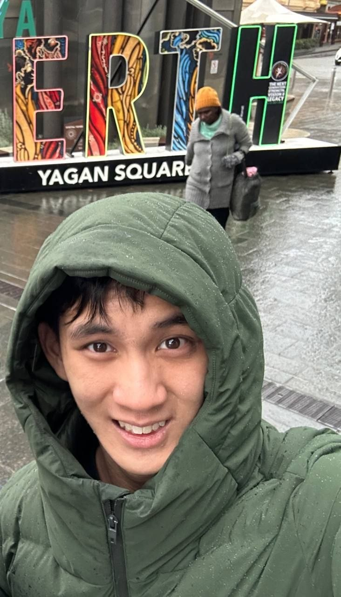
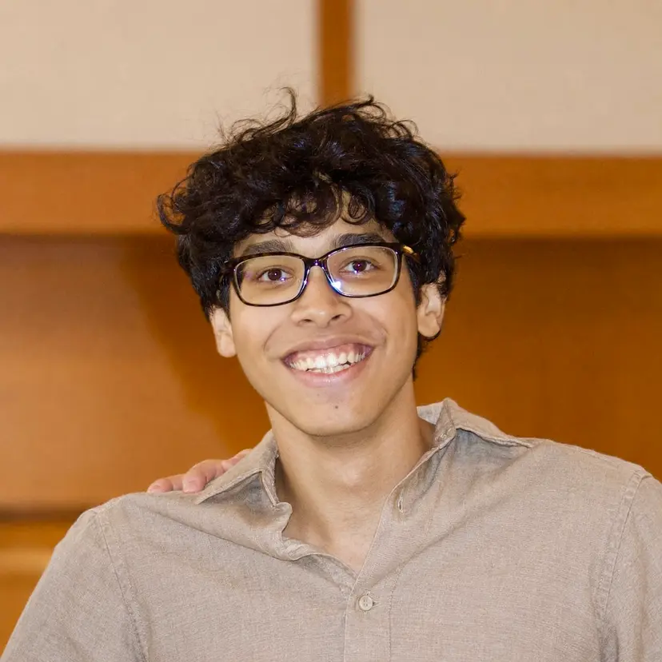
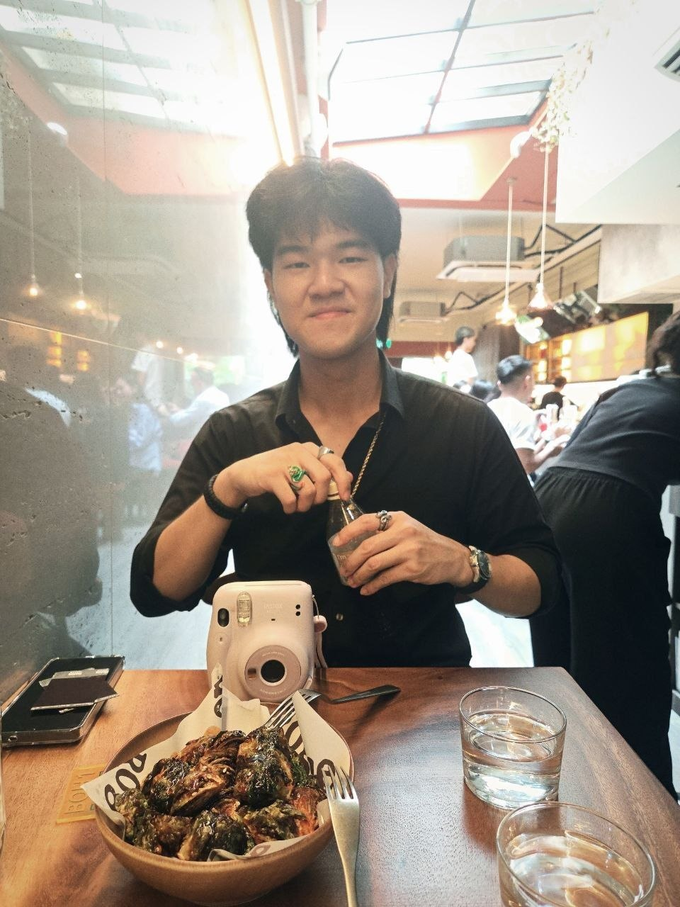
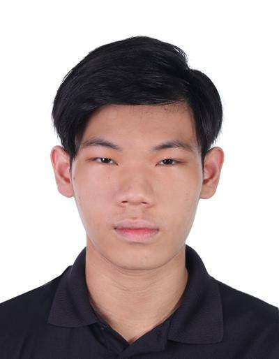
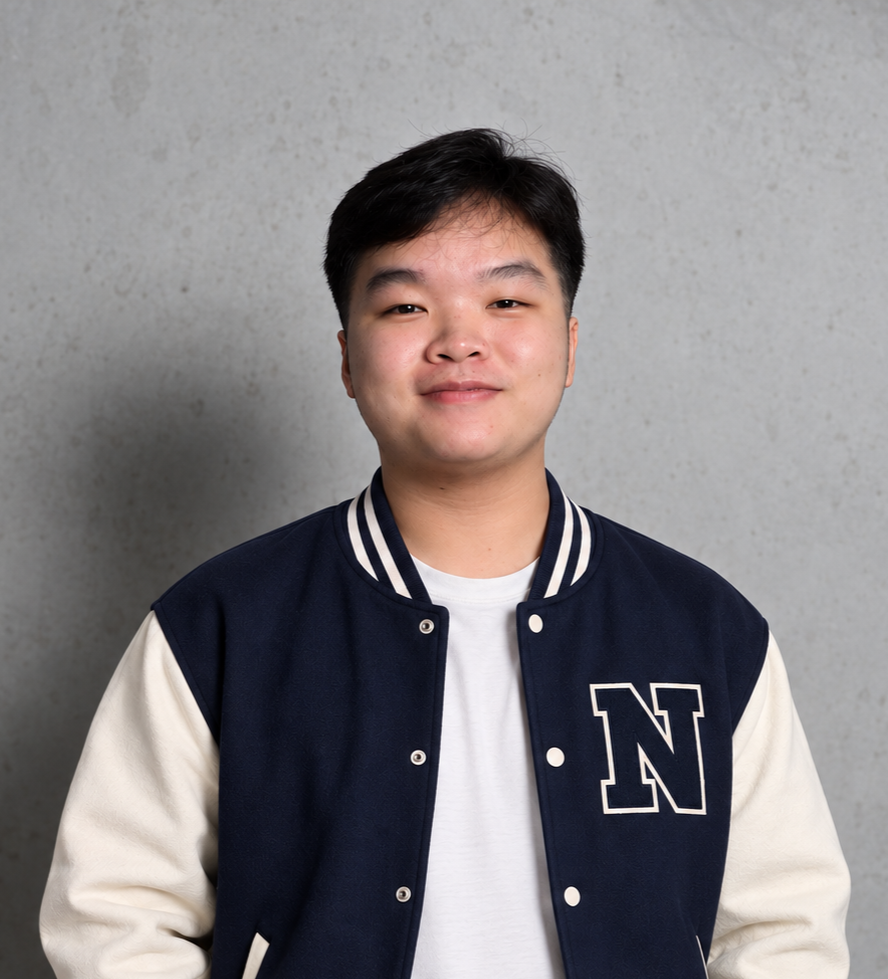

# About Us

We are a team based in the [School of Computing, National University of Singapore](http://www.comp.nus.edu.sg).

You can reach us through the [team issue tracker](https://github.com/AY2627S1-CS2103T-F15-2/tp/issues).

## Project team

### Keegan Gan

[[github](https://github.com/keegan4)]

* Role: CS2103T Team Member
* Responsibilities: Testing

### Keith Chia Wen Kai

[[github](https://github.com/wtvlol)]

* Role: CS2103T Team Member
* Responsibilities: Tab autocomplete, member and equipment deletion, Unicode command input, release packaging

### Arjo

[[github](https://github.com/ArjoDas)]

* Role: Code quality
* Responsibilities: Coding standards and code reviews

### Nicholas Vun

[[github](http://github.com/kimjunkuno)]
[[portfolio](team/kimjunkuno.md)]

* Role: Team Member
* Responsibilities: Testing

### Choong Jen Ern Isaac

[[github](https://github.com/isaaaxe)]

* Role: Integration, Fork CEO
* In charge of: Undo and redo, loan assignment and returns, data-file validation

### Nguyen Anh Duy

[[github](http://github.com/duynguyen21007)]

* Role: Testing
* In charge of: Directory search, filtering and sorting, command parsing, member name validation
