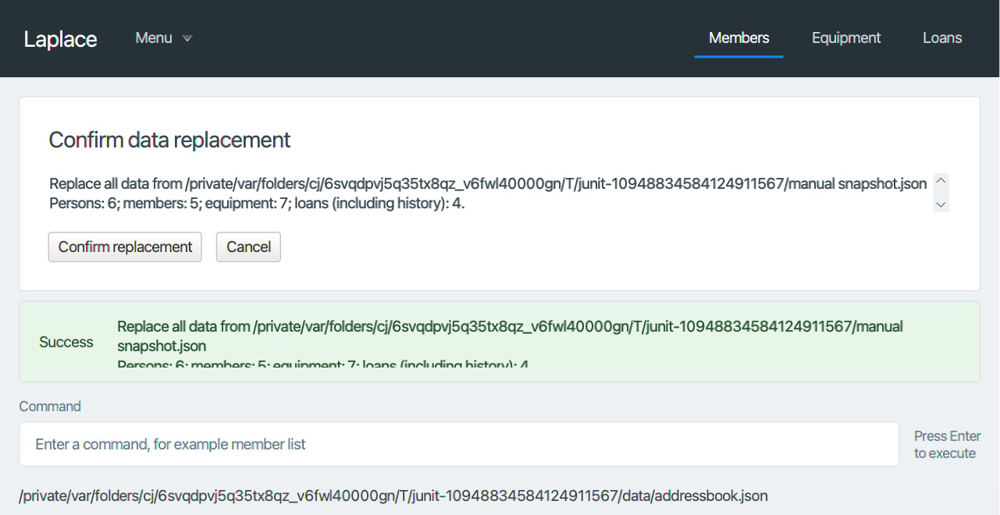

# Product-constraint verification

This record describes the data-transfer branch and its delivered artifact. Passing
tests are evidence for the scenarios exercised; they do not replace teaching-team
approval or the team's semester-long delivery assessment.

| Requirement | Evidence and remaining boundary |
| --- | --- |
| Evolve the supplied application | Existing AB3 parser, command, model, storage and JavaFX shell are extended. |
| Support users who prefer typing | Every import/export/backup/restore/confirm/cancel action has a typed command. |
| One operator | Local dataset for one operator; transfers support that operator's backup or migration. Shared use and operator rotation are not supported workflows. |
| Breadth-first incremental delivery | Team history contains successive feature integrations. The team must demonstrate consistent delivery across the full course period; this PR alone does not establish that. |
| Local, human-editable text | The live data and snapshots are JSON. The User Guide documents valid manual editing, identity/reference rules, backups and invalid-file recovery. Tests reload a valid manual contact edit and reject an invalid edit without modifying its bytes. |
| No DBMS | Persistence remains JSON files and Java model collections. |
| Primarily OOP | Commands, parsers, storage services and UI components retain the existing object-oriented structure. |
| Windows, Linux and macOS | Platform CI checks the code. A separate-JVM test starts the delivered artifact and exercises transfers without external JavaFX dependencies. Native support is Windows/Linux x64 and Intel/Apple Silicon macOS. |
| Java 25 without another Java version | Tests require Java 25. The separate-JVM artifact test restricts the runtime to Java SE/JDK support modules, preventing a JavaFX-enabled JDK from supplying missing dependencies. |
| No installer | Run `java -jar Laplace.jar`; no installer, database, account or separate JavaFX download is needed. |
| Approved third-party dependencies | No new framework or version is introduced. The additional macOS native classifier is from the same JavaFX 17.0.7 release. The team must retain evidence of course approval for its existing dependencies; this review does not certify approval. |
| GUI resolution and scaling | Automated viewport/scaled-render checks cover 1920x1080 at 100%/125% and 1280x720 at 150%, reserving 40 logical pixels for window/taskbar space and checking the command field and preview buttons remain accessible. These simulate layouts; physical desktop scale settings, window decorations and every feature screen still need manual release acceptance. |
| One deliverable | The build produces one self-contained `Laplace.jar`. The JavaFX/macOS native resource names contain universal libraries for both processor architectures. |
| Product below 100 MB | An artifact regression asserts the actual JAR is smaller than 100,000,000 bytes. Only the existing JavaFX native slices are combined; test images/session records are not bundled as runtime assets. |

## Standalone packaging correction

The previous JAR contained Intel-only macOS JavaFX natives. Tests that supplied
matching JavaFX libraries externally masked this distribution gap on Apple Silicon.
The build now wraps the original Intel and ARM64 slices in the documented universal
Mach-O container format. It preserves the original native code and architecture
metadata. The task is implemented using standard JVM I/O and runs on all three
build platforms, without requiring Apple's `lipo` tool or adding a runtime loader.

`StandaloneJarTest` checks every packaged macOS native has both architecture
headers and valid aligned slices, checks the 100 MB limit, and starts a separate
JVM using only the product JAR plus the test entrypoint. JavaFX classes and native
libraries must come from the artifact; named JavaFX modules are disabled.
The probe initializes the real MainApp and shell, exports/imports a complete
snapshot, exercises Cancel and Confirm, persists it and renders the scaled layouts.
Confirm and Cancel sit outside the scrollable summary so that long preview text
does not hide these actions at the smallest tested viewport.

Reproduce on Java 25:

```text
./gradlew test --tests '*StandaloneJarTest' --rerun-tasks
```

Output: `build/reports/laplace/standalone-session.txt` and
`build/reports/laplace/viewport-100.png`, `viewport-125.png`, `viewport-150.png`.
The complete transfer UI plan remains in `test/ui-test-plan.md` and is run by
`python3 scripts/run_transfer_ui_tests.py` with its fail-fast session record.

Recorded local artifact: **13,009,437 bytes**, below the 100 MB limit.
[Standalone Java SE console session](gui/StandaloneJavaSeSession.txt) ·
[1920x1080 at 100%](gui/DataTransferViewport-100.png) ·
[1920x1080 at 125%](gui/DataTransferViewport-125.png)

The 1280x720/150% simulation below reserves 40 logical pixels for desktop space;
the summary can scroll while both actions and the command field remain visible.



## Manual release checks still required

On the actual intended desktop setups, verify all navigation, details, long lists,
Help, command correction and transfer controls at the prescribed resolutions and
100%, 125% and 150% desktop scales. The automated rendered viewport checks do not
change the operating system's display scale and must not be described as physical
desktop acceptance. Keep the dependency-approval and semester-delivery evidence
with the team's release records.
