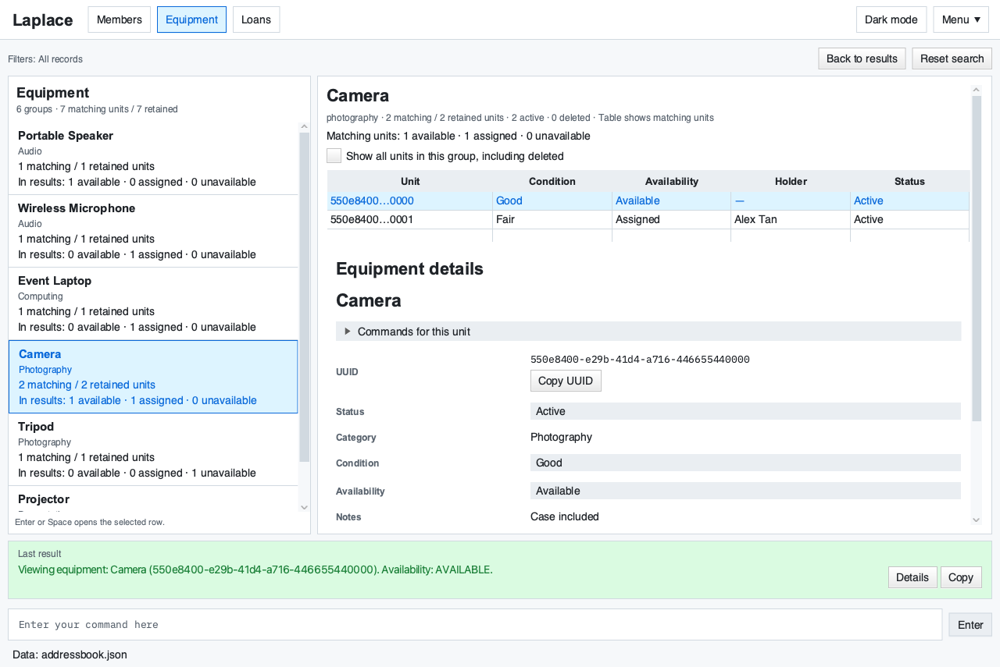
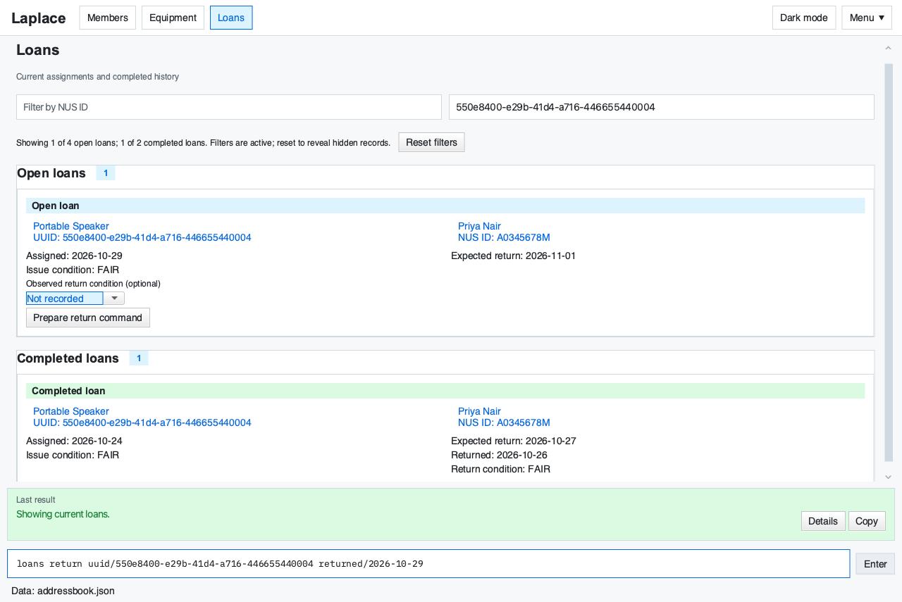

# Laplace User Guide

See the [search, filtering, sorting, inventory planning and duplicate warning reference](commands/search-and-planning.md).

Laplace helps a CCA EXCO member manage **members, equipment and equipment loans** on one computer.
Type commands to register records, find an exact member or item, issue equipment, record returns and
remove erroneous records. Lists and details show who holds each item and what each member holds.

This guide describes **seventeen member, equipment and loan commands**, including member and equipment
editing/restoration, batch equipment registration and search, with Tab autocomplete throughout:
seven member commands, seven equipment commands and three loan commands.
Use it with the matching release supplied by the team;
earlier builds may not support every behavior described here. Laplace is a local, single-user application.

<page-nav-print />

## Quick start

1. Install Java **25** for your operating system and processor architecture.
2. Download the matching JAR from the
   [team Releases page](https://github.com/AY2627S1-CS2103T-F15-2/tp/releases):
   **Laplace.jar** for Windows, Linux or Intel macOS; **Laplace-mac-arm64.jar** for Apple Silicon macOS.
   Each download is self-contained; you need only one JAR and Java 25.
3. Put the JAR in a folder you can write to. Keep the application and its data in this folder.
4. Open a terminal in that folder and run `java -jar Laplace.jar`. Substitute the actual filename
   if your supplied JAR has a different name. Keep the terminal open while using the application.
5. On the first launch without a saved data file, Laplace provides sample records. Existing saved data
   takes precedence; restarting does not add another set of samples.
6. Type `member list` in the command box and press **Enter**. Try `equipment list`, then `loans list`
   to open each directory and the current-loans tab.
7. Use `help` or **F1** to open Help, and `exit` to close the application normally.
8. Follow [A complete issue-and-return workflow](#a-complete-issue-and-return-workflow) to register a
   member and an item, issue the item and record its return. Keep the
   [Command summary](#command-summary) as a quick reference; each task links to its detailed section.

[](images/BetterUi.png)

*Equipment view in light mode, using the fictional first-launch samples. The available camera is selected.*
Open the image to inspect it at full size. Locate these five areas:

1. **Command input at the bottom:** type a command, review its values, then press **Enter** or the Enter button.
2. **Last result above the input:** read the outcome of the previous command. **Details** expands it;
   **Copy** includes the complete feedback and any generated UUIDs.
3. **Equipment groups on the left:** Camera represents two physical units with the same category and name.
   Its counts distinguish available and assigned units; selecting a group opens its table.
4. **Physical-unit table at the upper right:** each row is a separate UUID. The labels `550e8400…0000`
   and `550e8400…0001` distinguish the two cameras. Select a row to see that unit's condition and holder.
5. **Unit details below the table:** copy the full UUID here. Expand **Commands for this unit** to find
   command previews; **Use command** prepares the input for review and never executes it.


Command text uses [IBM Plex Mono](https://github.com/IBM/plex), distributed under the SIL Open Font License.

Screenshots use fictional records. The footer's `addressbook.json` is the default data filename, stored
under `data/` beside the JAR. Your rows, counts, dates and selected record depend on your data.
Both light and dark appearance are supported.
If startup fails, check the JAR filename and Java version and keep the terminal error for the team.
Do not delete your data file to troubleshoot startup.

### Completing commands and fields with Tab

Type part of a command in the command box and press **Tab** to complete it. For example,
`mem` becomes `member`, `member ad` becomes `member add`, and `member add na` becomes
`member add name/`. Member editing is supported too: `member ed` becomes `member edit`, with
`nus/`, `name/`, `phone/` and `email/` field and value suggestions. Member names always come from the
member directory, including during edits. Press Space yourself to begin the next word or field.

When several suggestions match, press Tab repeatedly to cycle through them in alphabetical order.
During that cycle, **Shift+Tab** selects the previous suggestion. Editing the input, moving the caret,
submitting a command, leaving the input, or changing the records starts a fresh cycle.

Laplace also completes existing field values: member names, phone numbers and emails; member IDs in
reference fields; equipment UUIDs, names and categories; and the four equipment conditions. For example,
`equipment add condition/g` completes to `equipment add condition/GOOD`. Values match without regard
to case and retain their stored spelling. Suggestions use the current records, including records added
since startup. Identical values appear once.

A matching stored value takes priority over an unfinished field prefix within that value. For example,
with a stored equipment name `Camera Cover`, `equipment add name/Camera co` completes to
`equipment add name/Camera Cover`. If no stored value matches, the final token can still complete
to a new field prefix. A trailing space offers the unused fields for the command.

Value matching treats repeated spaces and Unicode whitespace within a value as ordinary single spaces.
For example, `member edit name/Alex  T` can complete the stored name `Alex Tan`. The replacement keeps
the stored spelling, and all text and separators outside that value remain unchanged.

Command words ignore case; field prefixes remain case-sensitive. Field suggestions depend on the command and omit
non-repeatable prefixes already present. All seventeen member, equipment and loan commands plus `help`,
`exit`, `mode dark` and `mode light` have command completion. Search supports `q/`, the applicable filters, sorting and ordering;
finite options such as `status/de` complete to `status/DELETED`. Query text can reuse searchable stored
values. Equipment editing and both restoration commands support their fields and existing references.
Batch equipment creation includes `count/`; batch loan UUID completion fills the active comma-separated
entry, preserves the others and excludes UUIDs already listed. Return conditions are supported too.
New member IDs, dates, numeric counts and free-form notes remain manual. Completion does not guarantee that a command
can execute: ordinary validation still runs when you press Enter.

Tab changes only the active token or field value and preserves later fields and their separators,
including Unicode spaces copied into the input. It never executes a command or saves records. Press **Enter** to submit the completed input. With blank input, selected text, an
unsupported context, at the start of an existing field marker, or with no matching suggestion,
normal Tab navigation remains available. An untouched following marker and its value are preserved. Shift+Tab also
keeps its normal navigation behavior outside an active completion cycle.

### Sample records on first launch

When there is no saved data file, Laplace starts with five fictional members and seven equipment items.
The samples include two cameras, a damaged tripod, a microphone, a speaker, a projector under repair
and an event laptop. Three open loans illustrate current holders, one overdue item and a member holding
multiple items. Two closed loans show a FAIR speaker return and a GOOD-to-DAMAGED tripod return.
The assigned camera intentionally has no issue observation to demonstrate older unknown history.

Dates are relative to the day of first launch. Try `member list`, `equipment list` and `loans list`,
then copy displayed identities to view details or try a return. These are ordinary records:
additions, returns and deletions are saved normally. Existing saved data always takes precedence;
samples are not appended to it. To explore a fresh sample set, copy the JAR into a separate empty folder
and run that copy instead of removing your existing data file.

The equipment identities below are stable in a fresh sample set. The states and holders change as you
issue, return or delete records.

| Sample equipment | UUID | Initial availability | Current holder |
| --- | --- | --- | --- |
| Camera, case included | `550e8400-e29b-41d4-a716-446655440000` | AVAILABLE | None |
| Camera, strap included | `550e8400-e29b-41d4-a716-446655440001` | ASSIGNED | Alex Tan (`A0123456X`) |
| Tripod, damaged | `550e8400-e29b-41d4-a716-446655440002` | UNAVAILABLE | None |
| Wireless Microphone | `550e8400-e29b-41d4-a716-446655440003` | ASSIGNED | Jamie Lim (`A0234567R`), overdue |
| Portable Speaker | `550e8400-e29b-41d4-a716-446655440004` | AVAILABLE | None; previously returned |
| Projector, under repair | `550e8400-e29b-41d4-a716-446655440005` | UNAVAILABLE | None |
| Event Laptop | `550e8400-e29b-41d4-a716-446655440006` | ASSIGNED | Alex Tan (`A0123456X`) |

To explore without changing the sample records:

1. Run `loans list`. The Loans tab shows three open loans and the closed speaker/tripod loans in history.
2. Run `member view nus/A0123456X`. Alex's details show the camera and laptop under Held Equipment.
3. Run `equipment view uuid/550e8400-e29b-41d4-a716-446655440003`. The microphone's details identify
   Jamie as the holder and show its assignment and expected return dates.
4. Run `loans list` again to return to the Loans tab.

## Using the window

Each subsection below covers one task in the window. The commands themselves are described under
[Features](#features).

### Switch views and find records

**Members**, **Equipment** and **Loans** switch views. Member/equipment search criteria remain active
when switching tabs or opening details. **Back to results** returns to the current filtered summary;
**Reset search**, `member list` or `equipment list` clears that directory's criteria and sorting.

Member rows open member details. Copy buttons preserve full identifiers and contact fields. Related
member/equipment links open the exact record.

### Browse equipment groups and units

The left equipment directory groups units with the same normalized category and name, including units
registered in different batches. Open a group with a click, **Enter** or **Space**, then select a row in
its physical-unit table. Each unit still has its own UUID, condition, notes, holder and lifecycle state.

Group counts distinguish **matching** units from **retained** units. Availability counts exclude deleted
units. **Show all units** reveals group members outside the active search, including deleted records.
The right-hand **All retained groups** summary includes deleted-only groups regardless of the active
filter. Such a group shows zero active availability counts and its retained deleted count.

Direct `equipment view uuid/UUID` opens that exact unit, enabling Show all units if needed.
Unchecking it narrows the table again while retaining the selected unit's details; a message explains
when that unit is outside the table filter.

Short table identifiers show the first eight and last four UUID characters, such as
`550e8400…0000`. They are display labels only: hover for the full UUID, or copy it from unit details.

### Prepare commands from details

**Commands for this unit/member** in member and equipment details contains command previews:
**Copy** copies plain text; **Use command** prepares the input and never executes it. Replace the marked
uppercase placeholders and press Enter yourself. Availability and validation rules still apply.

### Track loans

The **Loans** tab shows current open assignments, exact-identity links, assigned/due dates and an
**Overdue** or **Due today** label when applicable. Rows reflow at narrower widths. **Prepare return command**
fills the input with the unit UUID and today's local date; review it before pressing Enter.

Filter both sections by NUS ID and equipment UUID. The filtered-result summary shows displayed versus
total counts in both sections, including records hidden after a successful batch command.
**Reset filters** explicitly reveals all records. Commands, tab navigation and `loans list` retain
intentional filters; mutations never silently clear them.

Urgency updates when you open Loans, execute a command or change records. Reopen Loans after midnight
to refresh the labels. Completed loans show return dates and recorded issue/return conditions, without
urgency labels or return actions. `loans list` opens this same tab; member and equipment details also
show the selected record's loan history.

Sections with more than ten loans use their own scrollable list. Scroll inside that list, or focus
it and use the arrow, Page Up/Down, Home and End keys, to reach all entries without loading every row at once.

### Read command feedback

**Last result** sits above the command feedback and stays after switching tabs. A green box is a
successful command, a red box is an error, and the box is neutral before the first command.
The heading displays only **Last result**; assistive text includes the status and full message.
**Details** expands the complete feedback and **Copy** includes all UUIDs from batch creation.

### Keyboard controls and Help

The command input, identifiers and command examples use IBM Plex Mono. Unmodified **↑/↓** browse up to
100 recent submissions in this session, preserving an unfinished draft. Modified arrows retain normal
text selection and caret navigation. History is cleared when the application closes.

**Ctrl+Space** offers command-name or parameter-prefix completion at the end of the input. Choose an
entry to insert it; **Escape** dismisses suggestions. Tab completes the active token or value as
described in [Completing commands and fields with Tab](#completing-commands-and-fields-with-tab); with no
applicable suggestion it retains normal focus navigation.

**F1** or `help` opens a scrollable command reference with copyable templates and the user-guide link.
The loan-return template includes `condition/GOOD` as an example of the optional observed return
condition. Ctrl+Space after `loans return co` also offers `condition/`; omit it to retain the existing
equipment condition, or supply one of the conditions documented in the loan-return section.

### Resize panels and scroll

Drag the directory divider to resize its panels. Scroll long lists/details vertically; the data filename
appears in the footer, with the full path available on hover.

### Reading the Loans view

[](images/LoansGuide.png)

*The sample Portable Speaker has been issued again to Priya Nair and the equipment UUID filter is active.
This is a later sample state, rather than the initial three open loans. Dates are illustrative.*
Open the image for full size.

1. **Filters and result summary at the top:** both sections match the entered UUID. The summary shows
   one of four open loans and one of two completed loans; **Reset filters** reveals the hidden records.
2. **Open loans:** inspect the current borrower, dates and issue condition. Choose an observed return
   condition if known, then use **Prepare return command**. The screenshot shows the prepared command
   in the bottom input; it has not been submitted. Review it and press Enter to record the return.
3. **Completed loans:** read the actual return date and recorded conditions. These entries show history
   and do not offer a return action. Scroll the Loans panel to reach further records.

### Appearance: `mode dark` and `mode light`

```text
mode dark
mode light
```

Use these commands or the header button labeled **Dark mode** or **Light mode**. The button names the appearance it will apply. **Menu** contains Help and Exit. The main window and Help switch together.
Light is the default for new and older preference files. The chosen mode is saved with window preferences
on normal exit and restored on the next launch. Changing mode preserves the current search and records.
Only `dark` and `light` are accepted; missing/extra arguments are errors. These are appearance utilities,
in addition to the seventeen member, equipment and loan commands.

## Command format and feedback

Command words are **case-insensitive**: `Member Add` and `member add` are equivalent.
`member`/`members` and `loan`/`loans` are explicit family aliases. `equipment` is uncountable;
`equipments`, `lists` and `returns` are not aliases. Field prefixes remain lowercase and case-sensitive.
Parameter values retain their existing validation and case rules; names and notes preserve their case.
Help, usage messages, Tab and Ctrl+Space suggestions use the canonical `member`, `equipment` and `loans` spellings.

- Replace uppercase placeholders with your values: replace `NUS_ID` with `A0123456X`, for example.
- Square brackets mean an optional parameter; do not type them. Optional parameters are marked in each command's syntax.
- Put spaces between command words and parameters. Parameters may appear in any order; tabs also separate fields.
- Each prefix may appear **at most once**, including `notes/`.
- Unicode whitespace, including EM SPACE and nonbreaking space, separates command words and parameters.
  Leading/trailing whitespace is ignored. Runs of whitespace in text values become one ordinary space.
- A value continues to the next parameter marker. A start-of-value or whitespace-delimited token such as
  `notes/` or `unknown/` is reserved as a marker. Unknown markers are errors, even inside free text.
  There is no quoting or escaping. An ordinary URL such as `https://example.com` is not a marker.
- Use the full field names: `nus/`, `name/`, `phone/` and `email/`. Short alternatives are not accepted.
- `member list`, `equipment list` and `loans list` take no arguments. Additional text or prefixes are rejected.
- An empty or whitespace-only submission does nothing.

On success, the input clears and the requested list/details view appears. Adding a member or one equipment
unit opens that record's details. Adding equipment with `count/2` or greater instead opens the full equipment
directory and resets its search filters and sorting; use the UUIDs in **Last result** to open individual units.
On failure, the command stays in the input box, focus returns there, and the current view and selection
remain unchanged. Correct it and press Enter again. Only the first detected error is shown; another error
may appear after correction. Rejected commands do not change records.

In feedback examples, `N` is the current count and uppercase placeholders such as `UUID`, `NUS_ID`
and `EQUIPMENT_NAME` stand for the actual record values. `TODAY` is the computer's local date.

### Unsupported AddressBook commands

The old top-level commands `add`, `edit`, `delete`, `clear`, `find`, and `list` are unsupported.
They return `Unknown command.` and do not change records or save the data file, even when arguments
are supplied. For example, use `member list` instead of `list members`, `equipment list` to view
inventory, and `member search q/Alex` to search members. There is no supported bulk-clear command.
Use the member, equipment and loan commands documented below, or `undo`, `redo`, `mode`, `help` and `exit`.

### Shared field rules

| Field | Accepted input and stored form |
| --- | --- |
| NUS ID `nus/` | One ASCII letter, exactly seven digits, and an optional final ASCII letter. Case-insensitive; stored/displayed uppercase, such as `A0123456X` or `E0123456`. |
| Member name `name/` | 1–100 Unicode code points after whitespace and NFC normalization. Unicode letters with combining marks, spaces, straight (`'`) or curly (`’`) apostrophes, hyphens and periods; must contain at least one letter. Combining marks must follow a letter or its marks. Examples: `அருண்`, `Anne O’Connor`. |
| Phone `phone/` | Optional leading `+`, then 8–15 digits. Spaces and hyphens are removed: `+65 9123-4567` becomes `+6591234567`. |
| Email `email/` | 3–254 ASCII characters, one `@`, no spaces and at least one domain dot. Local-part characters: letters, digits, `.`, `_`, `%`, `+`, `-`. Domain labels contain letters/digits/hyphens and cannot begin/end with a hyphen. ASCII validation occurs before conversion to lowercase; non-ASCII lookalikes such as `K` are rejected. Stored lowercase. |
| Equipment UUID `uuid/` | Full `8-4-4-4-12` hexadecimal form, such as `550e8400-e29b-41d4-a716-446655440000`. Case-insensitive input; lowercase display. Shortened UUIDs are rejected. |
| Equipment name `name/` | 1–100 printable Unicode characters after whitespace normalization. Punctuation and model numbers are allowed; control characters are rejected. |
| Category `category/` | 1–50 printable Unicode characters after normalization. Free text; control characters are rejected. |
| Condition `condition/` | Exactly `GOOD`, `FAIR`, `DAMAGED` or `UNDER_REPAIR`, ignoring case. Stored uppercase. Use the underscore in `UNDER_REPAIR`. |
| Notes `notes/` | Optional, at most 300 printable Unicode characters after trimming. Line breaks become spaces. Omitted or empty notes mean no notes. |
| Dates | Exactly `yyyy-MM-dd` with a Gregorian year from `0001` through `9999`, such as `2026-10-15`. Assignment/actual-return dates cannot be later than the computer's local date. Expected return may be in the future. |

Saved loan dates must also use the four-digit Gregorian range `0001`–`9999`. Year zero, negative years,
and five-digit years are invalid stored data. Loading does not compare historical dates with today's clock.

Copy the actual UUID displayed by Laplace when issuing, viewing, returning or deleting equipment.
The UUID in this guide is an example; it does not identify every newly added item.

Newly added or edited member names use Unicode NFC normalization: `José Tan` and `José Tan`
(with a separate combining acute accent) are stored as the same canonical spelling. Existing saved
names retain their exact spelling when loaded; editing another field does not rewrite the name.

### Availability

| Item state | Displayed availability | Can be assigned? |
| --- | --- | --- |
| Deleted unit, regardless of condition | `UNAVAILABLE` | No |
| Has an open loan, regardless of condition | `ASSIGNED` | No |
| Active, no open loan and condition `GOOD` or `FAIR` | `AVAILABLE` | Yes |
| Active, no open loan and condition `DAMAGED` or `UNDER_REPAIR` | `UNAVAILABLE` | No |

You do not enter availability or a holder manually. Laplace derives both from the item and its open loan.
Deleted units are retained for history but are UNAVAILABLE and cannot be assigned; restore the unit first.
A member can hold multiple different items; one physical item can have only one open loan.

### Correcting common errors

| Problem | What to do |
| --- | --- |
| Missing or blank required field | Supply a nonempty value for every required prefix shown in the command's usage. |
| Repeated prefix | Keep one occurrence of that prefix, including optional notes. |
| Unknown parameter or unexpected text | Remove the unrecognized marker or text before the first parameter. Check the full prefix names. |
| Invalid field | Follow the field rule above and the displayed field-specific explanation. |
| Unknown identity | Copy the full NUS ID or UUID from its list. Names and row numbers are not identifiers. |
| Command rejected by a loan rule | Return an assigned item before deleting its member/item or assigning that item again. |
| Data cannot be saved | Check that the application folder/data file are writable, correct the file-access problem, then retry. Failed MVP mutations leave records unchanged. |

## Features

Every command follows the [command format](#command-format-and-feedback),
[shared field rules](#shared-field-rules) and [availability](#availability) rules above. If a command
is rejected, see [Correcting common errors](#correcting-common-errors). The
[Command summary](#command-summary) lists every command and links back to its section here.

### Add a member: `member add`

Create one active member with a unique, immutable NUS ID.

```text
member add nus/NUS_ID name/NAME phone/PHONE email/EMAIL
```

All four parameters are required and follow the shared field rules. No address is required.

Examples:

```text
member add nus/A0678901D name/Jordan Lee phone/93456789 email/jordan.lee@u.nus.edu
member add email/siti@u.nus.edu name/Siti Nur phone/+65 8123-4567 nus/E0123456
```

Success adds the member, selects the new row and opens details showing the normalized values.
For the first example, the result is `New member added: Jordan Lee (A0678901D)`.
This example uses an ID absent from the bundled samples. If you have already added it, use another unused NUS ID.

Two members are duplicates **only when their normalized NUS IDs are equal**. Different IDs can share
a name, phone or email. A duplicate is rejected with a message such as:
`A member with NUS ID A0123456X already exists.`

A different NUS ID sharing a normalized name, phone or email with another **active** member is
accepted, with a `Possible duplicate(s)` advisory after the success message. Deleted members are
excluded from this advisory, but their retained NUS IDs still cannot be reused.
For example, in a fresh sample dataset, the second command above adds Siti under `E0123456` and reports:

```text
New member added: Siti Nur (E0123456)
Possible duplicate(s): A0456789B. Distinct identities are retained; review these records.
```

The addition has succeeded and been saved; do not resubmit it. Both NUS IDs remain separate records
with their own loan references. Use `member view nus/E0123456` and `member view nus/A0456789B` to review
the possible match before issuing equipment. A shared name or contact field can be legitimate; the
warning does not merge records. Expand **Last result → Details** to read the complete advisory.

Missing, blank, malformed, repeated or unknown parameters are rejected. Failure creates no member and
preserves the current view/selection. If saving fails, correct file access and retry the retained command.

### List members: `member list`

```text
member list
```

Show active and deleted members together, ordered by normalized name and then NUS ID. Each row shows
name, NUS ID, phone, email and **Items Held** count. Deleted cards are grey, with an italic,
struck-through name and a separate `(deleted)` suffix. They remain selectable. The summary shows
active, deleted and displayed counts. Archival is not supported.

The result is `Listed N active members.` Deleted records are counted separately when present.
If there are no records, the list displays:
`No members yet`

This command takes no parameters. For example, `member list nus/A0123456X` is rejected; use
`member view nus/A0123456X` for an exact lookup. A syntax failure leaves the current screen unchanged.
Inconsistent stored data produces an error rather than a partial list.

### View a member and their equipment: `member view`

```text
member view nus/NUS_ID
```

Example: `member view nus/a0123456x` finds the same identity as `member view nus/A0123456X`.

Details show the NUS ID, name, phone, email and current held-item count. The **Held Equipment** section
shows each open loan's full equipment UUID, name, assignment date and expected return date. Items are
ordered by **expected return date, equipment name, then UUID**. Returned items are not current holdings.
The matching member row is selected when the member list is visible.

Example feedback: `Viewing member: Alex Tan (A0123456X). Currently holds N item(s).`
With no current loans, the holdings section says `This member currently holds no equipment.`

| Situation | Result or correction |
| --- | --- |
| ID exists | Open that exact member's details; equal names do not affect lookup. |
| ID is well formed but does not exist | `No member with NUS ID NUS_ID exists.` Copy an existing ID from `member list`. |
| ID is incomplete or malformed | Correct it using the shared NUS ID rule. A well-formed shorter ID is still an exact identity, not a partial-name or partial-ID search. |
| Required parameter is missing, repeated or unknown | Correct the command to `member view nus/NUS_ID`. |
| A current loan refers to missing equipment | Report inconsistent stored loan data; do not show an incomplete holdings list. |

Failed viewing preserves the previous details and selection. This command covers both exact-ID lookup
and viewing a member's equipment; no separate member-find or member-loans command is needed.

### Edit a member: `member edit`

```text
member edit nus/NUS_ID [name/NAME] [phone/PHONE] [email/EMAIL]
```

Example: `member edit nus/a0123456x name/Anne-Marie Lim phone/+65 9876-5432`.

Supply the exact NUS ID and at least one detail to change. Names, phones and emails follow the
same validation and normalization as `member add`. Omitted fields keep their stored values.
The NUS ID cannot be changed; open and completed loans remain attached to the same member.
You can edit contact details while the member holds equipment. Matching another member's name
or contacts does not merge records because NUS IDs identify members.

Success reports `Edited member NUS_ID: NAME.` and opens the updated details. The directory
re-evaluates its current filters and sort order. Name then NUS ID is the default ordering; an explicit
sort such as `sort/id order/desc` remains active. The edited member stays selected when included in
the filtered results; their details still open if the edit moves them outside those results.
Changes survive restart.

| Situation | Result or correction |
| --- | --- |
| No editable fields supplied | Supply at least one of `name/`, `phone/` or `email/`. |
| Supplied values make no change | `The supplied details do not change this member.` No save occurs. |
| Member is deleted | Run `member restore nus/NUS_ID` before editing. |
| Member does not exist | `No member with NUS ID NUS_ID exists.` Check `member list`. |
| Blank, invalid, repeated or unknown field | Correct the field using the `member add` rules. |
| Saving fails | The previous details, loan history and saved file remain unchanged. |

### Delete a member: `member delete`

```text
member delete nus/NUS_ID
```

Example: `member delete nus/A0123456X`.

Delete one exact member **only if they currently hold no equipment**. Equal-name members with other
IDs remain. Success marks the member deleted, preserving their details, reserved NUS ID and all loan
history. They remain visible and selected in the directory with a grey card, italic struck-through
name and `(deleted)` suffix. A deleted member cannot receive new loans; restore them first.

Example feedback: `Deleted member A0123456X: Alex Tan.` The directory keeps the same member selected.
Viewing deleted details shows restore guidance. Repeating deletion is rejected without saving.

| Situation | Result or correction |
| --- | --- |
| Member holds equipment | `Cannot delete NUS_ID because the member holds N item(s). Return the items first.` Use `member view` to identify them. |
| Member is already deleted | Restore them first; repeated deletion is rejected without saving. |
| Member does not exist | `No member with NUS ID NUS_ID exists.` Check `member list`. |
| Malformed/missing/repeated/unknown parameter | Correct the identity or syntax and retry. |
| Saving fails | No records change. Correct file access before retrying. |

Deletion has no expiry and never clears a member record automatically. Return all outstanding items
with `loans return` before retrying blocked deletion. A failed save changes neither records nor saved bytes.

### Restore a member: `member restore`

```text
member restore nus/NUS_ID
```

Example: `member restore nus/a0123456x`.

Restore any deleted member at any time. There is no time limit, timestamp check, purge or separate
archive state. The same NUS ID, details and loan history are retained. Success reports
`Restored member NUS_ID: NAME.`, opens their details and removes the deleted styling. New loans
can then be assigned normally. An unknown identity, an already-active member or invalid arguments
are rejected without saving. A failed save leaves the member deleted and permits a later retry.

### Add equipment: `equipment add`

Register one or more physical units with the same details. Laplace generates a separate immutable UUID for each unit.

```text
equipment add name/NAME category/CATEGORY condition/CONDITION [notes/NOTES] [count/COUNT]
```

`name/`, `category/` and `condition/` are required. Notes are optional; `notes/` with no value also means
no notes. `count/` is optional and defaults to **1**. Supply a whole number from **1 to 100**, using
ASCII digits only; leading zeros are allowed. Blank counts, signs, fractions, repeated `count/` fields
and values outside this range are rejected. Do not supply `uuid/`, a holder or availability.
Follow the shared text limits and condition rules.

Examples:

```text
equipment add name/Canon EOS R50 category/Camera condition/GOOD notes/Includes battery and strap
equipment add name/Tripod category/Camera Support condition/fair
equipment add name/Camera Kit category/Photography condition/GOOD count/3 notes/Includes strap
```

For a count of 1, success creates one item, selects its row and opens its details. Feedback includes the generated UUID
and name, for example:
`New equipment added: Canon EOS R50 (550e8400-e29b-41d4-a716-446655440000), availability: AVAILABLE`.
Copy the **actual generated UUID**, which will normally differ from that example, for later commands.

For larger counts, success creates the entire batch, resets equipment search filters/sorting, and opens
the full equipment directory. Feedback reports the created count, name, availability and all generated
UUIDs, for example `Added 3 equipment units: Camera Kit, availability: AVAILABLE.` followed by `UUIDs:`.
Every unit has the same supplied details and its own UUID. Existing similar records may produce one
advisory duplicate warning; the new batch does not warn about its own intentionally matching units.

GOOD/FAIR items start as AVAILABLE. DAMAGED/UNDER_REPAIR items can be registered but start UNAVAILABLE.
Otherwise identical items are allowed: two cameras with the same description are separate physical units
with different UUIDs. Laplace silently retries a generated UUID collision; if it cannot obtain a unique
identifier, it reports an error without adding any units. The batch is saved as one operation: a failure
during creation or saving commits no new units. There is no stored quantity replacing individual records.

### List equipment: `equipment list`

```text
equipment list
```

Show all retained physical units, including deleted units, grouped by normalized **category and name**.
Groups follow category/name order; select a group to inspect its distinct units. The table shows condition,
availability, holder and lifecycle status, with the full UUID in a tooltip and the selected unit's details.
Matching descriptions share a directory row but retain separate identities. Default unit order is UUID;
a search's sorting applies to its matching units. Clicking a table heading temporarily sorts the table.

Feedback is `Listed N equipment items.` An empty list displays:
`No equipment yet. Use equipment add to get started.`

No parameters are accepted. Use `equipment view uuid/UUID` to look up one item. Syntax errors preserve
the current view. Inconsistent loan references produce an error rather than a partial or misleading
availability list.

### View equipment and its holder: `equipment view`

```text
equipment view uuid/UUID
```

Example: `equipment view uuid/550e8400-e29b-41d4-a716-446655440000`.
Uppercase hexadecimal letters identify the same UUID. You must use the complete UUID; shortened forms
and partial matching are not supported.

Details show the full UUID, name, category, condition, notes, lifecycle status and derived availability. An open loan also
shows the holder's NUS ID, name, phone and email, plus assignment and expected return dates. The matching
group and physical-unit rows are selected and scrolled into view when included in the current filters.
If the unit is outside those filters, its group opens with **Show all units** enabled. Current search
filters and any clicked table sort remain unchanged. Long notes wrap and scroll with the details.

| Item state | Example feedback |
| --- | --- |
| Has an open loan | `Viewing equipment: EQUIPMENT_NAME (UUID). Availability: ASSIGNED.` |
| Has no open loan and condition is GOOD/FAIR | `Viewing equipment: EQUIPMENT_NAME (UUID). Availability: AVAILABLE.` |
| Has no open loan and condition is DAMAGED/UNDER_REPAIR | `Viewing equipment: EQUIPMENT_NAME (UUID). Availability: UNAVAILABLE.` |

With no open loan, there is no holder and no current loan dates; old holder details are cleared after
return. A missing UUID produces `No equipment with UUID UUID exists.` Malformed UUIDs show the shared
validation error. Missing/repeated/unknown parameters are rejected. An open loan referring to a missing
member produces an inconsistent-data error instead of incomplete holder information. Failure leaves the
previous view and selection unchanged.

### Edit equipment: `equipment edit`

```text
equipment edit uuid/UUID [name/NAME] [category/CATEGORY] [condition/CONDITION] [notes/NOTES]
```

Supply the exact UUID and at least one field to change. Unspecified fields keep their existing values;
`notes/` with no value clears notes. Names, categories, conditions and notes follow the same validation
as equipment add. Duplicate/unknown parameters and unchanged edits are rejected without saving.

Example: `equipment edit uuid/550e8400-e29b-41d4-a716-446655440000 condition/DAMAGED notes/Lens needs repair`.

Only that physical unit changes. Its UUID and loan references remain intact; matching siblings are
unaffected. Changing the name/category changes its inventory group. You may edit a loaned unit,
including its condition: it remains ASSIGNED until returned, after which its new condition determines
availability. This does not record a separate condition-at-handover history. Deleted units must first
be restored. Success opens the edited unit's details; failed validation or saving changes nothing.

### Delete equipment: `equipment delete`

```text
equipment delete uuid/UUID
```

Example: `equipment delete uuid/550e8400-e29b-41d4-a716-446655440000`.

Soft-delete one exact item **only when it has no open loan**. Its condition does not prevent deletion.
The unit, UUID, details and closed loans are retained. Feedback includes the identity and name:
`Deleted equipment UUID: EQUIPMENT_NAME.` The equipment directory appears with its existing filters.
Deleted units remain visible in all-record lists, labeled `[DELETED]`; active-only searches exclude them.
They cannot be assigned and are excluded from active availability totals. Group retained counts include them.

| Situation | Result or correction |
| --- | --- |
| Item is on loan | `Cannot delete UUID because it is assigned to NUS_ID. Return the item first.` View it to confirm the holder. |
| UUID does not exist | `No equipment with UUID UUID exists.` Copy an existing UUID from `equipment list`. |
| UUID or syntax is invalid | Correct the full UUID/required prefix and retry. |
| Saving fails | The item and loan records remain unchanged. Correct file access and retry. |

Deleting one UUID never deletes other items with the same description. Repeated deletion is rejected.

### Restore equipment: `equipment restore`

```text
equipment restore uuid/UUID
```

Find retained units with `equipment search status/deleted` or `equipment list`, then restore one exact
UUID. There is no restoration time limit. The unit retains its identity, condition, notes and closed loan
history. A restored DAMAGED or UNDER_REPAIR unit remains UNAVAILABLE; GOOD/FAIR units become AVAILABLE.
Success opens its details. Unknown UUIDs, already-active units, invalid syntax and save failures do not
change records. Records permanently removed by older versions require an earlier backup to recover.

Equipment search defaults to active units. Use `status/active`, `status/deleted` or `status/all` alongside
other search filters; values are case-insensitive. Deleted units have derived UNAVAILABLE status, so
`equipment search status/deleted availability/available` returns no matches. `equipment list` resets
filters and includes both states. Total counts include retained units; availability counts and inventory
availability summaries cover active units only; retained group counts include deleted units. Deleted equipment can still be opened with `equipment view uuid/UUID`.

### Open the Loans tab: `loans list`

```text
loans list
```

Open the existing Loans tab, just as clicking **Loans** does. It shows current and completed loans,
with links to the corresponding member and equipment details. Use the NUS ID and UUID fields to
filter both sections. Each section has its own count and empty state.

Feedback is `Showing current loans.` This command does not create, return, delete or change any
member, equipment or loan records. It does not save the data file.
Extra text or parameters, such as `loans list uuid/UUID`, are rejected and leave the current view unchanged.

### Assign equipment: `loans add`

Assign one or more AVAILABLE physical items to an existing member.

```text
loans add uuid/UUID[,UUID...] nus/NUS_ID assigned/ASSIGNMENT_DATE expected/EXPECTED_RETURN_DATE
```

All four parameters are required. Use the actual UUID from `equipment list` and the NUS ID from
`member list`. Both identities must exist. Assignment must be on or before the computer's local date;
expected return must be on or after assignment. Expected return may be in the future.
In `UUID[,UUID...]`, the brackets and ellipsis describe optional additional UUIDs; do not type them.
Enter full UUIDs separated by commas, with one `uuid/` prefix for the entire list.

Example, assuming these identities exist and the assignment date is not in the future:

```text
loans add uuid/550e8400-e29b-41d4-a716-446655440000 nus/A0123456X assigned/2026-09-14 expected/2026-09-21
```

Success creates an open loan and immediately changes availability to ASSIGNED. Equipment details show
the holder/dates; the member's current holdings and item count update. Feedback is:
`Assigned EQUIPMENT_NAME (UUID) to MEMBER_NAME (NUS_ID) on ASSIGNMENT_DATE; expected return: EXPECTED_RETURN_DATE.`

A member may hold several different items. Separate multiple UUIDs with commas; every item shares the
member and dates, and the request succeeds or fails as a whole. The condition of each item at issue is
recorded in its loan history. Assigning an already assigned item is rejected, even if the new loan names
the same member. Reaching the expected return date does not automatically return an item.

Historical issue conditions are retained observations, including DAMAGED or UNDER_REPAIR if an older
record contains them. They do not change the item's current condition or authorize a new assignment.
Missing/null historical conditions remain "Not recorded"; Laplace never guesses an observation.

A new assignment must be on or after that unit's latest recorded actual return date. Same-day handoffs
are allowed. A conflicting UUID rejects the entire batch; expected-return dates do not determine
historical availability. This check applies to new assignments and does not rewrite retained history.

| Situation | Result or correction |
| --- | --- |
| Equipment/member does not exist | `No equipment with UUID UUID exists.` or `No member with NUS ID NUS_ID exists.` Check the corresponding list. |
| Equipment or member is deleted | Restore that record before assigning it; an invalid unit rejects the entire batch. |
| Item already has an open loan | `Equipment UUID is unavailable because it is assigned to CURRENT_NUS_ID.` Return it before assigning it again. |
| Condition is DAMAGED/UNDER_REPAIR | `Equipment UUID is unavailable (condition: CONDITION).` Choose an AVAILABLE item. |
| Expected date precedes assignment | `Expected return date cannot be before assigned date` |
| Assignment precedes a retained actual return | `Equipment UUID cannot be assigned before its last recorded return date DATE.` Use that date or later. |
| Assignment is in the future | `Assigned date cannot be after today (TODAY).` Check your entry and the computer's date. |
| Field syntax/date is invalid | Correct the first reported parameter and retry; use a real `yyyy-MM-dd` date. |
| Saving fails | No loan is recorded and no records change; correct file access before retrying. |


When several units fail validation, the result summarizes how many are invalid and lists each UUID's
first blocking reason in input order. Open **Details** to expand the complete list or **Copy** to copy
it. One invalid unit keeps its specific diagnostic. Shared member/date and syntax errors are reported
before unit checks when they prevent meaningful validation. No loans or conditions change on rejection.

On failure, no loan is created. Availability, holder, holdings, view and selection stay unchanged.

#### Worked example: assign two units together

Use a disposable copy of the JAR in a separate empty writable folder, with no saved data beside it.
Launch that copy to obtain the [fresh sample records](#sample-records-on-first-launch).
These commands assume first launch on **29 October 2026**. On another day, replace `2026-10-29`
throughout this example and the return example below with today's local date, and replace `2026-11-05`
with an expected date on or after assignment. The sample speaker already has completed history relative
to launch day; using today's assignment date avoids overlapping it.

Run `equipment list` and `member view nus/A0123456X`. The camera ending in `0000` must be active,
GOOD and AVAILABLE; the speaker ending in `0004` must be active, FAIR and AVAILABLE. Alex Tan must be
active. Copy each **full UUID** from its equipment details, rather than the shortened table label.
With your own data, replace both UUIDs and the member ID below with existing eligible records.

Submit this as one command:

```text
loans add uuid/550e8400-e29b-41d4-a716-446655440000,550e8400-e29b-41d4-a716-446655440004 nus/A0123456X assigned/2026-10-29 expected/2026-11-05
```

The result opens Loans and reports `Assigned 2 units to Alex Tan (A0123456X) on 2026-10-29; expected
return: 2026-11-05.`, followed by the Camera and Portable Speaker names and full UUIDs. Expand
**Last result → Details** or use **Copy** for the full per-unit feedback. Both units become ASSIGNED;
Alex's holdings gain both units, and each new loan records its own issue condition (GOOD and FAIR).
Use **Reset filters** in Loans if either new row is hidden by a filter.

If either unit is already assigned, deleted, unavailable or otherwise rejected, **neither assignment
is saved**. Check both units before correcting and retrying the batch.

### Return equipment: `loans return`

```text
loans return uuid/UUID[,UUID...] returned/ACTUAL_RETURN_DATE [condition/CONDITION]
```

UUID and date are required. Equipment must exist and have open loans. Referenced members
must also exist. The return date must be **from the assignment date through the computer's local date**,
inclusive. Same-day, early and late returns are valid; the expected return date does not limit returns.

Example, for the single-unit assignment dated 14 September above and a computer date on or after
20 September 2026:

```text
loans return uuid/550e8400-e29b-41d4-a716-446655440000 returned/2026-09-20
```

Success records the actual return date and closes that item's open loan. Equipment details clear its
holder/loan dates, the item leaves the member's current holdings, and open-loan counts refresh.
Availability becomes AVAILABLE for GOOD/FAIR, or UNAVAILABLE for DAMAGED/UNDER_REPAIR.
Feedback is `Returned EQUIPMENT_NAME (UUID) from MEMBER_NAME (NUS_ID) on ACTUAL_RETURN_DATE.`

Multiple UUIDs return in one request. If `condition/` is supplied, it is recorded for every item
and updates each item's current condition. Use separate commands for different observed conditions.
The Loans row offers an **Observed return condition (optional)** choice before **Prepare return command**.
Choose a condition you actually observed to include `condition/` in the prepared text, or leave
**Not recorded** to omit it. Preparing never submits the command; review and press Enter yourself.
No issue/current condition is preselected as a new observation.

If omitted, the current equipment condition stays unchanged and history shows the return condition
as "Not recorded". A failed item prevents the entire batch from being returned.
Batch feedback starts with a concise count/date summary. Expand **Details** for each equipment name,
full UUID and its own borrower name/NUS ID; **Copy** retains the complete result. Batch assignments
similarly list names/full UUIDs beneath their shared borrower/date summary. Different borrowers are
never attributed to a single borrower in a batch return.

| Situation | Result or correction |
| --- | --- |
| Equipment does not exist | `No equipment with UUID UUID exists.` Check the full UUID. |
| No open loan, including an already returned item | `Equipment UUID has no open loan to return.` A repeated return is rejected. |
| Return is before assignment | `Cannot return NAME (UUID) on RETURN_DATE: it was assigned on ASSIGNED_DATE.` Correct the identified unit's date; the whole batch remains unchanged. |
| Return is in the future | `Returned date cannot be after today (TODAY).` |
| Missing/repeated/unknown field or invalid date | Correct the reported parameter and use the full command syntax. |
| Open loan refers to a missing member | `Cannot return equipment UUID: its open loan refers to a missing member.` Preserve the data and report the error to the team. |
| Saving fails | No return is recorded and no records change; correct file access and retry. |

Batch return errors use the same combined result and Details/Copy actions as assignment errors.
A rejected return leaves the loan, return date, holder and availability unchanged. Completed loans
appear in the Loans tab and in member and equipment details.

#### Worked example: return both units with one observed condition

Continue immediately after the two-unit assignment above in the same disposable dataset. Both units
must still have those open loans. Suppose you inspect **both** and observe DAMAGED condition.
For this same-day demonstration, submit:

```text
loans return uuid/550e8400-e29b-41d4-a716-446655440000,550e8400-e29b-41d4-a716-446655440004 returned/2026-10-29 condition/DAMAGED
```

Use the same full UUIDs and date substitutions as in the assignment example. On a later actual return,
use that actual date, which must be no earlier than assignment and no later than today.
The single `condition/DAMAGED` applies to **both units**. Use separate return commands if their
observed conditions differ; the brackets/ellipsis in the syntax are not literal input.

Feedback begins `Returned 2 units on 2026-10-29.`. **Last result → Details** and **Copy** include each
unit's name, full UUID and borrower. Both loans move from current to completed loans, Alex no longer
holds these two units, and both units become DAMAGED and UNAVAILABLE. Alex's other loans remain open.
In Loans, use **Reset filters** to reveal all rows, then inspect completed loans or open each unit's
details and loan history. The new completed records retain GOOD/FAIR issue conditions and show the
recorded DAMAGED return condition and actual return date; earlier completed history is retained.

If either unit has no open loan or any return validation fails, **neither loan closes and neither
condition changes**. A rejected unit prevents the whole batch from succeeding.

### Undo a record change: `undo`

Both `undo` and `redo` appear in Help. Type `und` or `red` and use Tab or Ctrl+Space to complete
the command name. Help's Use command action only prepares it; press Enter to execute.

```text
undo
```

Undo the most recent successful record-changing command. Laplace retains **up to ten changes in the
current session**. An eleventh successful change discards the oldest undo step. Each command counts as
one step: a batch equipment creation, loan assignment or return is undone together.

Supported changes are member/equipment addition, editing, deletion and restoration, plus loan assignment
and return. Undo restores linked records, original UUIDs, loan dates and conditions together. For example,
undoing a loan return reopens the loan and restores its previous holder and equipment condition.
Undoing equipment creation removes those units; redoing it restores their original UUIDs.

Success reports the action, for example `Undid: equipment add.`. If none is available, the error is
`Nothing to undo.`. Undo takes no arguments: `undo 2` is rejected. The current screen refreshes while
preserving search criteria; if the displayed record no longer exists, its directory appears instead.
Active filters can hide restored records; use the directory's list command to reset the search.

### Redo an undone change: `redo`

```text
redo
```

Restore the most recently undone change. Up to ten redo steps are available after ten undos. Success
reports, for example, `Redid: equipment add.`. If none is available, the error is `Nothing to redo.`.
Redo takes no arguments. It restores the recorded state without generating new UUIDs or dates.

A **new successful record-changing command after undo clears redo**. Listing, searching, viewing, Help,
appearance changes, rejected commands and no-change edits neither add history nor clear redo. Window
preferences, appearance and search criteria are not undone. The command input's arrow-key history is
separate from record undo/redo.

Every successful undo/redo is saved automatically. A save failure leaves records and undo/redo history
unchanged; correct the file-access problem and retry. History is kept **only until Laplace closes**.
Restarting loads the most recently saved records with no undo/redo steps available. The ten-step limit
also means this feature does not replace a backup.

Example:

```text
equipment add name/Camera category/Photo condition/GOOD count/3
undo
redo
```

This creates three units, removes all three, then restores the same three units. Type these commands in
the existing command input; there are no dedicated undo/redo buttons or keyboard shortcuts.

## A complete issue-and-return workflow

Use a new member ID if the example ID already exists. The dates below are examples for a computer date
on or after 20 September 2026; choose valid actual dates for your own operation.

1. Register the member:
   `member add nus/E0678901C name/Mei Tan phone/91234567 email/mei@example.com`.
2. Register an item:
   `equipment add name/Camera Kit category/Photography condition/GOOD notes/Includes strap`.
3. Copy the UUID generated in step 2. **Replace `UUID` in the remaining steps with that value.**
4. Assign it:
   `loans add uuid/UUID nus/E0678901C assigned/2026-09-14 expected/2026-09-21`.
5. Run `member view nus/E0678901C` and `equipment view uuid/UUID`. Check the holdings, holder and dates.
6. Return it: `loans return uuid/UUID returned/2026-09-20`.
7. View both records again. The member has no current holding for this item; the GOOD item is AVAILABLE.
8. If these were erroneous/test records, remove them with `equipment delete uuid/UUID` and
   `member delete nus/E0678901C`. Both deletions retain records; use `equipment restore` or `member restore` to recover them.

## Saving, file access and recovery

Successful changes save automatically; there is no manual-save command. For the packaged application,
data is stored in `data/addressbook.json` inside the folder containing `Laplace.jar`, even if you launch
the JAR from another terminal folder. `preferences.json` and rotating `addressbook.log.*` files also
stay beside the JAR. Substitute your actual JAR filename, such as `Laplace-mac-arm64.jar`, where needed.
The following procedures use your operating system's file manager; Laplace has no in-app backup,
restore, import or export command.

### Locate your saved data

Hover over **Data: addressbook.json** in the window footer to see the full path actually in use.
If startup fails, use the **Data file:** path in the **Could not load saved data** dialog instead.
Record this path before closing Laplace. Use it for every copy or replacement below; the terminal's
current folder may be different from the JAR's folder.

The data file contains members, equipment and open/completed loans, including retained deleted records.
`preferences.json` contains window and appearance settings; it is not a records backup.
Logs do not provide a complete dataset that Laplace can restore.

List, search and view commands, `help`, and `exit` do not save member, equipment or loan records.
They remain usable when the loaded data cannot be saved, and do not rewrite the data file or create
one on first launch. Normal exit still saves window and appearance preferences separately.

For Laplace mutation commands, a failed save leaves the live records and previously saved data
unchanged. An error is not a successful addition, deletion, assignment or return. The command remains
available for correction. Fix the folder/file access problem, then retry. Do not repeatedly resubmit a
successful command: duplicate members, already-assigned items and repeated returns are rejected.

### Make a backup

1. Locate the data file as described above. If possible, note a few member IDs, equipment UUIDs and
   current holders to check after a restore.
2. Type `exit` and wait for Laplace to close. Close any other instance using the same dataset.
3. **Copy**, rather than move, the data file to a separate backup location. Give the copy a dated name,
   for example `addressbook-2026-10-29.json`. Keep earlier known-good backups instead of overwriting them.
4. Check that the backup exists and has the same size as the source. Keep it in a safe location;
   a copy on another device also protects against losing the original computer.

If no data file exists, first-launch samples may only be in memory: list/view commands and normal exit
do not create the records file. There is no saved dataset to copy in that case. Do not substitute
preferences or logs for a data backup. Never edit the data file while Laplace is running or run
multiple instances against it.

### Restore a known-good backup

Restoring replaces the entire saved dataset; changes made since that backup will not be present.
It does not merge records or restore the previous session's undo/redo history.

1. Identify the actual data path and close every instance of Laplace. For a startup error, dismiss
   the dialog and wait for the application to stop.
2. If a current file exists, preserve it, even if it appears invalid, by copying it to a separate location
   with a distinct name such as `addressbook-before-restore-2026-10-29.json`. Keep the known-good backup too.
3. Copy the known-good backup into the actual data folder. Rename the installed copy to
   `addressbook.json`, replacing the current file only after preserving it. Create the `data` folder
   if needed. Check that the filename has not become `addressbook.json.json` or `addressbook.json.txt`.
4. Launch a compatible release from that JAR folder. Use the same release that wrote the backup
   where possible; do not downgrade lifecycle-aware data to a release that may discard deletion state.
5. Run `member list`, `equipment list` and `loans list`. Reset any Loans filters, then compare member
   IDs, equipment UUIDs, open loans and current holders with the backup's expected state. Check retained
   deleted records and completed history where relevant. Counts alone do not establish that this is
   the intended dataset.

If loading fails again, keep both copies, record the error and follow the
[startup-failure procedure](#handle-a-startup-failure).
Do not issue new loans until you have verified the restored records.

### Move to another computer

1. On the original computer, locate the data file, close Laplace and make a backup using the steps above.
2. Put a compatible JAR for the destination computer's operating system/processor in a writable folder.
   Keep Laplace closed on that computer while installing the data. Preserve any destination dataset first.
3. Copy the backup to `data/addressbook.json` inside the destination JAR's folder. Keep its member IDs,
   equipment UUIDs and loan references intact; do not combine JSON files by pasting their arrays together.
   Copying `preferences.json` is optional; leaving it out uses default window and appearance settings.
4. Launch that JAR and perform the record checks in the restore procedure, including open loans and holders.
   Keep the original dataset and backup until the destination has been verified. Continue working on one
   copy to avoid two datasets diverging.

If migrating files from a release that stored them relative to the launch folder, preserve the old
data and preferences before copying them to the locations beside the current JAR. Laplace does not
automatically discover or move those older files.

### Handle a startup failure

1. If **Could not load saved data** appears, record its **Data file:** path. Laplace preserves the
   original data file and opens no editable directory or command box. Dismiss the dialog and wait
   for startup to stop. For other launch failures, check Java 25 and the JAR filename, and retain the
   terminal error; do not replace the dataset just because Java could not start.
2. With Laplace closed, copy the problematic file to a safe location before changing it. Check that
   the indicated file and its folder can be read. For permission problems, correct file access and retry.
3. If a known-good backup exists, [restore it](#restore-a-known-good-backup), then verify the restored records.
4. If no backup exists, retain the original and work on a copy. A correct manual repair may recover
   records still present in the file; see [manual editing and compatibility](#advanced-manual-editing-and-compatibility).
   Ask the team for help with the error if unsure. Missing or overwritten records cannot be reconstructed
   automatically from preferences, logs or a new sample dataset.

To explore samples while resolving the problem, copy **only the JAR** into a separate empty writable
folder and launch that copy. Its own missing data file causes a fresh fictional sample set to load.
This does not restore your records. Launching the original JAR from another terminal folder still uses
the original JAR's data path. Do not overwrite the preserved file with empty JSON or sample records.

### Advanced: manual editing and compatibility

Correct manual edits to the local JSON file are supported: Laplace loads data that meets its JSON,
field, identity and cross-record validation rules. Prefer normal commands for routine changes.
Close Laplace, back up the file and edit a disposable copy first, keeping valid JSON and every required
reference. Check the edited copy with a compatible JAR in its own folder before installing it in the
original location. Changing a member NUS ID or equipment UUID without updating all loan references
invalidates the dataset; preserving identities is safer.

A single UTF-8 byte-order mark at the very start of a JSON file is accepted for editor compatibility.
Saving writes ordinary UTF-8 without a BOM. Embedded text characters are preserved; repeated or
misplaced markers and genuinely malformed JSON remain invalid. A marker does not permit a null
root or content after the single JSON root; both are rejected without changing the saved bytes.

Invalid data is rejected as a complete load, without replacing the file with samples or an empty book.
Examples include a JSON `null` root, non-whitespace content after the root object, duplicate identities,
missing loan references and invalid field values. For conversion/reference errors, loading diagnostics
identify the collection, zero-based record position and available NUS ID/UUID. Keep the diagnostic
when asking the team for help. If a view reports inconsistent data after loading, stop making changes,
close the app and preserve the file for investigation; an incomplete view is not evidence that the
remaining data is safe to overwrite.

For compatibility with older files, absent or null `members`, `equipment` and `loans` collections
mean empty collections, just like `[]`. Saving writes these forms as arrays. A null collection cannot
recover records already removed from the input; restore a backup if records should have been present.
No schema-version distinction is inferred from null.

Data includes members, equipment and open/closed loan records. Availability and holders are derived;
do not try to maintain separate holder/availability fields. Member deletion retains the record,
its `deleted` boolean and closed loans for unlimited restoration. Equipment follows the same policy.
Older member/equipment records without a `deleted` field load as active;
explicit null or non-boolean values are invalid. Stored equipment, issue and return conditions accept
case-insensitive spellings and surrounding whitespace; saves use GOOD, FAIR, DAMAGED or UNDER_REPAIR.
Blank/unknown values are rejected, while missing/null historical loan conditions remain unknown. Do not open lifecycle-aware data in an older release
that may discard deletion state.

JSON property names must be unique within each object. Repeated collection or record fields are
rejected rather than choosing one value and losing the other. If loading reports a duplicate field,
close Laplace without entering commands, preserve the original file and repair a separate copy.

The saved root still requires a `persons` array for legacy compatibility. For a dataset with no legacy
contacts, keep `"persons": []`; omitting it or writing null is rejected with `Persons list is missing.`
Populated legacy arrays are retained and saved even though their old commands are unavailable. Do not
remove an existing array during recovery. Current saves always include it.

When running development classes with Gradle, runtime files are relative to the project working folder.
Packaged JARs use their own folder instead. Keep development and operational datasets separate.

Command diagnostics record that input was received and, at detailed log levels, the recognized command
type. They omit raw input and contact values, including rejected input. Existing logs from older
versions may still contain commands recorded before this change. Logs are diagnostic evidence, not a
replacement for a known-good data backup.

## FAQ

**Why are two identical equipment items shown?** Each physical unit has its own UUID. Equal names,
categories, conditions and notes are allowed. Use the UUID to choose the unit you mean.

**How do I find a member or current holder?** Use `member view nus/NUS_ID` for exact member details and
holdings, or `equipment view uuid/UUID` for an exact item and its current holder. To browse without an
exact identifier, use `member search q/TEXT` or `equipment search q/TEXT`; `q/` matches a
case-insensitive substring of the searchable fields. Fuzzy or typo-tolerant matching and separate
member-find/holder commands are outside the MVP.

**Why can I not delete a record?** A member with an open loan or equipment currently on loan cannot be
deleted. Return the relevant items first. Closed loans do not block deletion. They are retained for
both soft-deleted members and equipment.

**Can I register broken equipment?** Yes. DAMAGED/UNDER_REPAIR records are UNAVAILABLE and cannot be
assigned. Use `equipment edit uuid/UUID condition/GOOD` after repairing a unit. Member contact details can be changed with `member edit`.

**Does an overdue loan close itself?** No. Record an actual return using `loans return`. A return later
than expected is valid if it is no earlier than assignment and no later than the computer's local date.

**Why do I not see the sample records?** Laplace loads your existing saved file instead of adding samples
to it, even if that file contains no records. To try the bundled examples, launch the JAR from a separate
empty folder after copying the JAR there. Keep your existing data file and backup intact.

**How do I move my data?** Follow [Move to another computer](#move-to-another-computer), which includes
backing up the source, preserving any destination data and checking the copied records and open loans.

**Where is Help?** Enter `help` or press F1. Use `exit` for normal shutdown; saved window preferences are
reused within usable screen bounds. These utilities are separate from the seventeen member, equipment
and loan commands, including `loans list`.

The **Menu** contains **Help** and **Exit**. Help displays the address of the
[Laplace User Guide](https://ay2627s1-cs2103t-f15-2.github.io/tp/UserGuide.html);
use **Copy URL** to copy its address and open it in your browser.

## MVP limits

The MVP supports member and equipment editing, soft deletion and restoration, plus search with filters
and user-selected sorting. Batch equipment registration supports 1–100 physical units per
`equipment add` command using `count/COUNT`; each unit receives its own UUID. Loan assignment and return
also accept multiple equipment UUIDs in one command. Bulk editing, deletion and restoration are not supported.

The MVP excludes separate find/member-loans/holder commands, import/export, fuzzy search
and automatic overdue notifications. Copying a backup file while the app
is closed is a file-management task, not an import/export command. Data is local to one operator;
authentication and concurrent multi-user operation are not provided.

## Command summary

| Task | Format |
| --- | --- |
| [Add member](#add-a-member-member-add) | `member add nus/NUS_ID name/NAME phone/PHONE email/EMAIL` |
| [Edit member](#edit-a-member-member-edit) | `member edit nus/NUS_ID [name/NAME] [phone/PHONE] [email/EMAIL]` |
| [List members](#list-members-member-list) | `member list` |
| [Search, filter and sort members](commands/search-and-planning.md#members) | `member search [q/TEXT] [holding/HOLDING] [status/STATUS] [sort/FIELD] [order/ORDER]` |
| [View member and current holdings](#view-a-member-and-their-equipment-member-view) | `member view nus/NUS_ID` |
| [Soft-delete member](#delete-a-member-member-delete) | `member delete nus/NUS_ID` |
| [Restore member](#restore-a-member-member-restore) | `member restore nus/NUS_ID` |
| [Add equipment](#add-equipment-equipment-add) | `equipment add name/NAME category/CATEGORY condition/CONDITION [notes/NOTES] [count/COUNT]` |
| [List equipment](#list-equipment-equipment-list) | `equipment list` |
| [Search, filter and sort equipment](commands/search-and-planning.md#equipment) | `equipment search [q/TEXT] [category/TEXT] [condition/CONDITION] [availability/AVAILABILITY] [status/STATUS] [sort/FIELD] [order/ORDER]` |
| [View equipment and current holder](#view-equipment-and-its-holder-equipment-view) | `equipment view uuid/UUID` |
| [Edit equipment](#edit-equipment-equipment-edit) | `equipment edit uuid/UUID [name/NAME] [category/CATEGORY] [condition/CONDITION] [notes/NOTES]` |
| [Restore equipment](#restore-equipment-equipment-restore) | `equipment restore uuid/UUID` |
| [Delete equipment](#delete-equipment-equipment-delete) | `equipment delete uuid/UUID` |
| [Open the Loans tab](#open-the-loans-tab-loans-list) | `loans list` |
| [Assign equipment](#assign-equipment-loans-add) | `loans add uuid/UUID[,UUID...] nus/NUS_ID assigned/ASSIGNMENT_DATE expected/EXPECTED_RETURN_DATE` |
| [Return equipment](#return-equipment-loans-return) | `loans return uuid/UUID[,UUID...] returned/ACTUAL_RETURN_DATE [condition/CONDITION]` |
| [Undo the last record change](#undo-a-record-change-undo) | `undo` |
| [Redo the last undone change](#redo-an-undone-change-redo) | `redo` |

For `equipment add`, omitting `count/` or using `count/1` opens the new unit's details. A successful
`count/2` or greater opens the full equipment directory and resets its filters and sorting, as described
under [Add equipment](#add-equipment-equipment-add).

See [search, filters and sorting](commands/search-and-planning.md) for accepted search parameter values.

Application utilities: `undo` and `redo` navigate up to ten record changes per session; `mode dark` / `mode light` change appearance; `help` (or F1) opens Help; `exit` closes Laplace.
