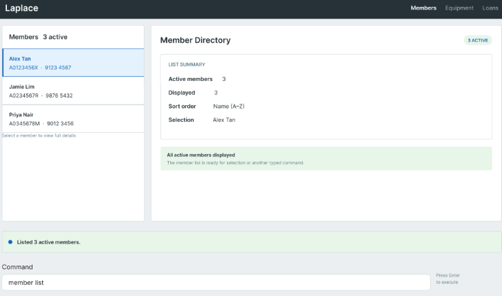

# Laplace User Guide

Laplace helps a CCA EXCO member manage **members, equipment and equipment loans** on one computer.
Type commands to register records, find an exact member or item, issue equipment, record returns and
remove erroneous records. Lists and details show who holds each item and what each member holds.

This guide describes the **MVP release plus member editing, soft-delete, restoration,
`loans list` navigation, and Tab autocomplete**: thirteen member, equipment and loan commands in total.
Use it with the matching release supplied by the team;
earlier builds may not support every behavior described here. Laplace is a local, single-user application.

<page-nav-print />

## Quick start

1. Install Java **25** for your operating system and processor architecture.
2. Obtain the Laplace MVP JAR supplied by the team. Published builds are listed on the
   [team Releases page](https://github.com/AY2627S1-CS2103T-F15-2/tp/releases).
3. Put the JAR in a folder you can write to. Keep the application and its data in this folder.
4. Open a terminal in that folder and run `java -jar Laplace.jar`. Substitute the actual filename
   if your supplied JAR has a different name. Keep the terminal open while using the application.
5. On the first launch without a saved data file, Laplace provides sample records. Existing saved data
   takes precedence; restarting does not add another set of samples.
6. Type `member list` in the command box and press **Enter**. Try `equipment list`, then `loans list`
   to open each directory and the current-loans tab.
7. Use `help` or **F1** to open Help, and `exit` to close the application normally.



The image is a layout reference. Your rows, counts and selected record depend on your data.
If startup fails, check the JAR filename and Java version and keep the terminal error for the team.
Do not delete your data file to troubleshoot startup.

### Completing commands and fields with Tab

Type part of a command in the command box and press **Tab** to complete it. For example,
`mem` becomes `member`, `member ad` becomes `member add`, and `member add na` becomes
`member add name/`. Member editing is supported too: `member ed` becomes `member edit`, with
`nus/`, `name/`, `phone/` and `email/` field and value suggestions. Member names always come from the
member directory, including during edits. Press Space yourself to begin the next word or field.

When several suggestions match, press Tab repeatedly to cycle through them in alphabetical order.
During that cycle, **Shift+Tab** selects the previous suggestion. Editing the input, moving the caret,
submitting a command, leaving the input, or changing the records starts a fresh cycle.

Laplace also completes existing field values: member names, phone numbers and emails; member IDs in
reference fields; equipment UUIDs, names and categories; and the four equipment conditions. For example,
`equipment add condition/g` completes to `equipment add condition/GOOD`. Values match without regard
to case and retain their stored spelling. Suggestions use the current records, including records added
since startup. Identical values appear once.

Command words and field prefixes are case-sensitive. Field suggestions depend on the command and omit
non-repeatable prefixes already present. New member IDs, dates and notes remain manual. Existing legacy
address-book commands have command-word completion only. Completion does not guarantee that a command
can execute: ordinary validation still runs when you press Enter.

Tab changes only the active token or field value and preserves later fields. It never executes a command
or saves records. Press **Enter** to submit the completed input. With blank input, selected text, an
unsupported context, at the start of an existing field marker, or with no matching suggestion,
normal Tab navigation remains available. An untouched following marker and its value are preserved. Shift+Tab also
keeps its normal navigation behavior outside an active completion cycle.

### Sample records on first launch

When there is no saved data file, Laplace starts with five fictional members and seven equipment items.
The samples include two cameras, a damaged tripod, a microphone, a speaker, a projector under repair
and an event laptop. Three open loans illustrate current holders, one overdue item and a member holding
multiple items. One closed loan is retained internally and is hidden from the Loans tab.

Dates are relative to the day of first launch. Try `member list`, `equipment list` and `loans list`,
then copy displayed identities to view details or try a return. These are ordinary records:
additions, returns and deletions are saved normally. Existing saved data always takes precedence;
samples are not appended to it. To explore a fresh sample set, run the JAR from a separate empty folder
instead of removing your existing data file.

The equipment identities below are stable in a fresh sample set. The states and holders change as you
issue, return or delete records.

| Sample equipment | UUID | Initial availability | Current holder |
| --- | --- | --- | --- |
| Camera, case included | `550e8400-e29b-41d4-a716-446655440000` | AVAILABLE | None |
| Camera, strap included | `550e8400-e29b-41d4-a716-446655440001` | ASSIGNED | Alex Tan (`A0123456X`) |
| Tripod, damaged | `550e8400-e29b-41d4-a716-446655440002` | UNAVAILABLE | None |
| Wireless Microphone | `550e8400-e29b-41d4-a716-446655440003` | ASSIGNED | Jamie Lim (`A0234567R`), overdue |
| Portable Speaker | `550e8400-e29b-41d4-a716-446655440004` | AVAILABLE | None; previously returned |
| Projector, under repair | `550e8400-e29b-41d4-a716-446655440005` | UNAVAILABLE | None |
| Event Laptop | `550e8400-e29b-41d4-a716-446655440006` | ASSIGNED | Alex Tan (`A0123456X`) |

To explore without changing the sample records:

1. Run `loans list`. The Loans tab shows three open loans; the closed speaker loan is hidden.
2. Run `member view nus/A0123456X`. Alex's details show the camera and laptop under Held Equipment.
3. Run `equipment view uuid/550e8400-e29b-41d4-a716-446655440003`. The microphone's details identify
   Jamie as the holder and show its assignment and expected return dates.
4. Run `loans list` again to return to the Loans tab.

## Using the window

- **Members** opens the member directory. **Equipment** opens the equipment directory.
- The left panel contains selectable records. The right panel shows a directory summary or record
  details. Startup selects the first member, when present, while leaving the summary visible.
- Click a record, or focus its row and press **Enter** or **Space**, to open its details.
  Identically named records remain distinguishable by NUS ID or equipment UUID.
- The **Loans** tab shows current open assignments and links to their member and equipment.
  Type `loans list` to open the same tab. Completed loan history is not a user-facing feature.
- The feedback area reports the last command's result. The command box and Enter hint appear below it.
- At smaller sizes, use the list/detail scrollbars to reach long identifiers, notes and holdings.

## Command format and feedback

Commands and prefixes are **lowercase and case-sensitive**. Use `member add`, not `Member Add`.

- Replace uppercase placeholders with your values: replace `NUS_ID` with `A0123456X`, for example.
- Square brackets mean an optional parameter; do not type them. Only equipment notes are optional.
- Put spaces between command words and parameters. Parameters may appear in any order; tabs also separate fields.
- Each prefix may appear **at most once**, including `notes/`.
- Leading/trailing whitespace is ignored. Runs of whitespace in text values become one ordinary space.
- A value continues to the next parameter marker. A start-of-value or whitespace-delimited token such as
  `notes/` or `unknown/` is reserved as a marker. Unknown markers are errors, even inside free text.
  There is no quoting or escaping. An ordinary URL such as `https://example.com` is not a marker.
- Use the full field names: `nus/`, `name/`, `phone/` and `email/`. Short alternatives are not accepted.
- `member list`, `equipment list` and `loans list` take no arguments. Additional text or prefixes are rejected.
- An empty or whitespace-only submission does nothing.

On success, the input clears and the requested list/details view appears. Newly added records are selected
and open in details. On failure, the command stays in the input box, focus returns there, and the current
view and selection remain unchanged. Correct it and press Enter again. Only the first detected error is
shown; another error may appear after correction. Rejected commands do not change records.

In feedback examples, `N` is the current count and uppercase placeholders such as `UUID`, `NUS_ID`
and `EQUIPMENT_NAME` stand for the actual record values. `TODAY` is the computer's local date.

### Shared field rules

| Field | Accepted input and stored form |
| --- | --- |
| NUS ID `nus/` | One ASCII letter, exactly seven digits, and an optional final ASCII letter. Case-insensitive; stored/displayed uppercase, such as `A0123456X` or `E0123456`. |
| Member name `name/` | 1–100 characters after normalization. Unicode letters, spaces, apostrophes, hyphens and periods only; must contain at least one letter. Example: `Anne-Marie O'Connor`. |
| Phone `phone/` | Optional leading `+`, then 8–15 digits. Spaces and hyphens are removed: `+65 9123-4567` becomes `+6591234567`. |
| Email `email/` | 3–254 ASCII characters, one `@`, no spaces and at least one domain dot. Local-part characters: letters, digits, `.`, `_`, `%`, `+`, `-`. Domain labels contain letters/digits/hyphens and cannot begin/end with a hyphen. Stored lowercase. |
| Equipment UUID `uuid/` | Full `8-4-4-4-12` hexadecimal form, such as `550e8400-e29b-41d4-a716-446655440000`. Case-insensitive input; lowercase display. Shortened UUIDs are rejected. |
| Equipment name `name/` | 1–100 printable Unicode characters after whitespace normalization. Punctuation and model numbers are allowed; control characters are rejected. |
| Category `category/` | 1–50 printable Unicode characters after normalization. Free text; control characters are rejected. |
| Condition `condition/` | Exactly `GOOD`, `FAIR`, `DAMAGED` or `UNDER_REPAIR`, ignoring case. Stored uppercase. Use the underscore in `UNDER_REPAIR`. |
| Notes `notes/` | Optional, at most 300 printable Unicode characters after trimming. Line breaks become spaces. Omitted or empty notes mean no notes. |
| Dates | Exactly `yyyy-MM-dd` and a real Gregorian calendar date, such as `2026-10-15`. Assignment/actual-return dates cannot be later than the computer's local date. Expected return may be in the future. |

Copy the actual UUID displayed by Laplace when issuing, viewing, returning or deleting equipment.
The UUID in this guide is an example; it does not identify every newly added item.

### Availability

| Item state | Displayed availability | Can be assigned? |
| --- | --- | --- |
| Has an open loan, regardless of condition | `ASSIGNED` | No |
| No open loan and condition `GOOD` or `FAIR` | `AVAILABLE` | Yes |
| No open loan and condition `DAMAGED` or `UNDER_REPAIR` | `UNAVAILABLE` | No |

You do not enter availability or a holder manually. Laplace derives both from the item and its open loan.
A member can hold multiple different items; one physical item can have only one open loan.

### Correcting common errors

| Problem | What to do |
| --- | --- |
| Missing or blank required field | Supply a nonempty value for every required prefix shown in the command's usage. |
| Repeated prefix | Keep one occurrence of that prefix, including optional notes. |
| Unknown parameter or unexpected text | Remove the unrecognized marker or text before the first parameter. Check the full prefix names. |
| Invalid field | Follow the field rule above and the displayed field-specific explanation. |
| Unknown identity | Copy the full NUS ID or UUID from its list. Names and row numbers are not identifiers. |
| Command rejected by a loan rule | Return an assigned item before deleting its member/item or assigning that item again. |
| Data cannot be saved | Check that the application folder/data file are writable, correct the file-access problem, then retry. Failed MVP mutations leave records unchanged. |

## Features

### Add a member: `member add`

Create one active member with a unique, immutable NUS ID.

```text
member add nus/NUS_ID name/NAME phone/PHONE email/EMAIL
```

All four parameters are required and follow the shared field rules. No address is required.

Examples:

```text
member add nus/A0123456X name/Alex Tan phone/91234567 email/alex.tan@u.nus.edu
member add email/siti@u.nus.edu name/Siti Nur phone/+65 8123-4567 nus/E0123456
```

Success adds the member, selects the new row and opens details showing the normalized values.
For the first example, the result is `New member added: Alex Tan (A0123456X)`.

Two members are duplicates **only when their normalized NUS IDs are equal**. Different IDs can share
a name, phone or email. A duplicate is rejected with a message such as:
`A member with NUS ID A0123456X already exists.`

Missing, blank, malformed, repeated or unknown parameters are rejected. Failure creates no member and
preserves the current view/selection. If saving fails, correct file access and retry the retained command.

### List members: `member list`

```text
member list
```

Show active and deleted members together, ordered by normalized name and then NUS ID. Each row shows
name, NUS ID, phone, email and **Items Held** count. Deleted cards are grey, with an italic,
struck-through name and a separate `(deleted)` suffix. They remain selectable. The summary shows
active, deleted and displayed counts. Archival is not supported.

The result is `Listed N active members.` Deleted records are counted separately when present.
If there are no records, the list displays:
`No members yet. Use member add to get started.`

This command takes no parameters. For example, `member list nus/A0123456X` is rejected; use
`member view nus/A0123456X` for an exact lookup. A syntax failure leaves the current screen unchanged.
Inconsistent stored data produces an error rather than a partial list.

### View a member and their equipment: `member view`

```text
member view nus/NUS_ID
```

Example: `member view nus/a0123456x` finds the same identity as `member view nus/A0123456X`.

Details show the NUS ID, name, phone, email and current held-item count. The **Held Equipment** section
shows each open loan's full equipment UUID, name, assignment date and expected return date. Items are
ordered by **expected return date, equipment name, then UUID**. Returned items are not current holdings.
The matching member row is selected when the member list is visible.

Example feedback: `Viewing member: Alex Tan (A0123456X). Currently holds N item(s).`
With no current loans, the holdings section says `This member currently holds no equipment.`

| Situation | Result or correction |
| --- | --- |
| ID exists | Open that exact member's details; equal names do not affect lookup. |
| ID is well formed but does not exist | `No member with NUS ID NUS_ID exists.` Copy an existing ID from `member list`. |
| ID is incomplete or malformed | Correct it using the shared NUS ID rule. A well-formed shorter ID is still an exact identity, not a partial-name or partial-ID search. |
| Required parameter is missing, repeated or unknown | Correct the command to `member view nus/NUS_ID`. |
| A current loan refers to missing equipment | Report inconsistent stored loan data; do not show an incomplete holdings list. |

Failed viewing preserves the previous details and selection. This command covers both exact-ID lookup
and viewing a member's equipment; no separate member-find or member-loans command is needed.

### Edit a member: `member edit`

```text
member edit nus/NUS_ID [name/NAME] [phone/PHONE] [email/EMAIL]
```

Example: `member edit nus/a0123456x name/Anne-Marie Lim phone/+65 9876-5432`.

Supply the exact NUS ID and at least one detail to change. Names, phones and emails follow the
same validation and normalization as `member add`. Omitted fields keep their stored values.
The NUS ID cannot be changed; open and completed loans remain attached to the same member.
You can edit contact details while the member holds equipment. Matching another member's name
or contacts does not merge records because NUS IDs identify members.

Success reports `Edited member NUS_ID: NAME.` and opens the updated details. The directory
re-sorts by name and NUS ID while keeping the edited member selected. Changes survive restart.

| Situation | Result or correction |
| --- | --- |
| No editable fields supplied | Supply at least one of `name/`, `phone/` or `email/`. |
| Supplied values make no change | `The supplied details do not change this member.` No save occurs. |
| Member is deleted | Run `member restore nus/NUS_ID` before editing. |
| Member does not exist | `No member with NUS ID NUS_ID exists.` Check `member list`. |
| Blank, invalid, repeated or unknown field | Correct the field using the `member add` rules. |
| Saving fails | The previous details, loan history and saved file remain unchanged. |

### Delete a member: `member delete`

```text
member delete nus/NUS_ID
```

Example: `member delete nus/A0123456X`.

Delete one exact member **only if they currently hold no equipment**. Equal-name members with other
IDs remain. Success marks the member deleted, preserving their details, reserved NUS ID and all loan
history. They remain visible and selected in the directory with a grey card, italic struck-through
name and `(deleted)` suffix. A deleted member cannot receive new loans; restore them first.

Example feedback: `Deleted member A0123456X: Alex Tan.` The directory keeps the same member selected.
Viewing deleted details shows restore guidance. Repeating deletion is rejected without saving.

| Situation | Result or correction |
| --- | --- |
| Member holds equipment | `Cannot delete NUS_ID because the member holds N item(s). Return the items first.` Use `member view` to identify them. |
| Member is already deleted | Restore them first; repeated deletion is rejected without saving. |
| Member does not exist | `No member with NUS ID NUS_ID exists.` Check `member list`. |
| Malformed/missing/repeated/unknown parameter | Correct the identity or syntax and retry. |
| Saving fails | No records change. Correct file access before retrying. |

Deletion has no expiry and never clears a member record automatically. Return all outstanding items
with `loans return` before retrying blocked deletion. A failed save changes neither records nor saved bytes.

### Restore a member: `member restore`

```text
member restore nus/NUS_ID
```

Example: `member restore nus/a0123456x`.

Restore any deleted member at any time. There is no time limit, timestamp check, purge or separate
archive state. The same NUS ID, details and loan history are retained. Success reports
`Restored member NUS_ID: NAME.`, opens their details and removes the deleted styling. New loans
can then be assigned normally. An unknown identity, an already-active member or invalid arguments
are rejected without saving. A failed save leaves the member deleted and permits a later retry.

### Add equipment: `equipment add`

Register one physical item and let Laplace generate its immutable UUID.

```text
equipment add name/NAME category/CATEGORY condition/CONDITION [notes/NOTES]
```

`name/`, `category/` and `condition/` are required. Notes are optional; `notes/` with no value also means
no notes. Do not supply `uuid/`, a holder or availability. Follow the shared text limits and condition rules.

Examples:

```text
equipment add name/Canon EOS R50 category/Camera condition/GOOD notes/Includes battery and strap
equipment add name/Tripod category/Camera Support condition/fair
```

Success creates one item, selects its row and opens its details. Feedback includes the generated UUID
and name, for example:
`New equipment added: Canon EOS R50 (550e8400-e29b-41d4-a716-446655440000), availability: AVAILABLE`.
Copy the **actual generated UUID**, which will normally differ from that example, for later commands.

GOOD/FAIR items start as AVAILABLE. DAMAGED/UNDER_REPAIR items can be registered but start UNAVAILABLE.
Otherwise identical items are allowed: two cameras with the same description are separate physical units
with different UUIDs. Laplace silently retries a generated UUID collision; if it cannot obtain a unique
identifier, it reports an error without adding an item. A save failure also commits no new item.

### List equipment: `equipment list`

```text
equipment list
```

Show every equipment item, ordered by normalized **category, name, then UUID**. Rows expose the UUID,
name, category, condition, derived availability and current holder when assigned. An unassigned item has
no current holder. Identical descriptions remain separate rows.

Feedback is `Listed N equipment items.` An empty list displays:
`No equipment yet. Use equipment add to get started.`

No parameters are accepted. Use `equipment view uuid/UUID` to look up one item. Syntax errors preserve
the current view. Inconsistent loan references produce an error rather than a partial or misleading
availability list.

### View equipment and its holder: `equipment view`

```text
equipment view uuid/UUID
```

Example: `equipment view uuid/550e8400-e29b-41d4-a716-446655440000`.
Uppercase hexadecimal letters identify the same UUID. You must use the complete UUID; shortened forms
and partial matching are not supported.

Details show the full UUID, name, category, condition, notes and derived availability. An open loan also
shows the holder's NUS ID, name, phone and email, plus assignment and expected return dates. The matching
equipment row is selected when its list is visible. Long notes wrap and scroll with the details.

| Item state | Example feedback |
| --- | --- |
| Has an open loan | `Viewing equipment: EQUIPMENT_NAME (UUID). Availability: ASSIGNED.` |
| Has no open loan and condition is GOOD/FAIR | `Viewing equipment: EQUIPMENT_NAME (UUID). Availability: AVAILABLE.` |
| Has no open loan and condition is DAMAGED/UNDER_REPAIR | `Viewing equipment: EQUIPMENT_NAME (UUID). Availability: UNAVAILABLE.` |

With no open loan, there is no holder and no current loan dates; old holder details are cleared after
return. A missing UUID produces `No equipment with UUID UUID exists.` Malformed UUIDs show the shared
validation error. Missing/repeated/unknown parameters are rejected. An open loan referring to a missing
member produces an inconsistent-data error instead of incomplete holder information. Failure leaves the
previous view and selection unchanged.

### Delete equipment: `equipment delete`

```text
equipment delete uuid/UUID
```

Example: `equipment delete uuid/550e8400-e29b-41d4-a716-446655440000`.

Permanently delete one exact item **only when it has no open loan**. Its condition does not prevent
deletion. Success removes the item and its associated closed loans, leaving unrelated records intact.
Feedback includes the identity and name: `Deleted equipment UUID: EQUIPMENT_NAME.` The equipment
directory appears with a surviving selection or an empty state; deleted-item details disappear.

| Situation | Result or correction |
| --- | --- |
| Item is on loan | `Cannot delete UUID because it is assigned to NUS_ID. Return the item first.` View it to confirm the holder. |
| UUID does not exist | `No equipment with UUID UUID exists.` Copy an existing UUID from `equipment list`. |
| UUID or syntax is invalid | Correct the full UUID/required prefix and retry. |
| Saving fails | The item and loan records remain unchanged. Correct file access and retry. |

Deleting one UUID never deletes other items with the same description. Deletion cannot be undone.

### Open the Loans tab: `loans list`

```text
loans list
```

Open the existing Loans tab, just as clicking **Loans** does. It shows current open loans and links
to the corresponding member and equipment details. If there are no open loans, the tab shows its
empty state. Closed loan history is not displayed.

Feedback is `Showing current loans.` This command does not create, return, delete or change any
member, equipment or loan records. It uses the same save/error handling as the other list commands.
Extra text or parameters, such as `loans list uuid/UUID`, are rejected and leave the current view unchanged.

### Assign equipment: `loans add`

Assign one AVAILABLE physical item to an existing member.

```text
loans add uuid/UUID nus/NUS_ID assigned/ASSIGNMENT_DATE expected/EXPECTED_RETURN_DATE
```

All four parameters are required. Use the actual UUID from `equipment list` and the NUS ID from
`member list`. Both identities must exist. Assignment must be on or before the computer's local date;
expected return must be on or after assignment. Expected return may be in the future.

Example, assuming these identities exist and the assignment date is not in the future:

```text
loans add uuid/550e8400-e29b-41d4-a716-446655440000 nus/A0123456X assigned/2026-09-14 expected/2026-09-21
```

Success creates an open loan and immediately changes availability to ASSIGNED. Equipment details show
the holder/dates; the member's current holdings and item count update. Feedback is:
`Assigned EQUIPMENT_NAME (UUID) to MEMBER_NAME (NUS_ID) on ASSIGNMENT_DATE; expected return: EXPECTED_RETURN_DATE.`

A member may hold several different items. Assigning an already assigned item is rejected, even if the
new loan names the same member. Reaching the expected return date does not automatically return an item.

| Situation | Result or correction |
| --- | --- |
| Equipment/member does not exist | `No equipment with UUID UUID exists.` or `No member with NUS ID NUS_ID exists.` Check the corresponding list. |
| Item already has an open loan | `Equipment UUID is unavailable because it is assigned to CURRENT_NUS_ID.` Return it before assigning it again. |
| Condition is DAMAGED/UNDER_REPAIR | `Equipment UUID is unavailable (condition: CONDITION).` Choose an AVAILABLE item. |
| Expected date precedes assignment | `Expected return date cannot be before assigned date` |
| Assignment is in the future | `Assigned date cannot be after today (TODAY).` Check your entry and the computer's date. |
| Field syntax/date is invalid | Correct the first reported parameter and retry; use a real `yyyy-MM-dd` date. |
| Saving fails | No loan is recorded and no records change; correct file access before retrying. |

On failure, no loan is created. Availability, holder, holdings, view and selection stay unchanged.

### Return equipment: `loans return`

```text
loans return uuid/UUID returned/ACTUAL_RETURN_DATE
```

Both parameters are required. The equipment must exist and have an open loan. Its referenced member
must also exist. The return date must be **from the assignment date through the computer's local date**,
inclusive. Same-day, early and late returns are valid; the expected return date does not limit returns.

Example, for the assignment above and a computer date on or after 20 September 2026:

```text
loans return uuid/550e8400-e29b-41d4-a716-446655440000 returned/2026-09-20
```

Success records the actual return date and closes that item's open loan. Equipment details clear its
holder/loan dates, the item leaves the member's current holdings, and open-loan counts refresh.
Availability becomes AVAILABLE for GOOD/FAIR, or UNAVAILABLE for DAMAGED/UNDER_REPAIR.
Feedback is `Returned EQUIPMENT_NAME (UUID) from MEMBER_NAME (NUS_ID) on ACTUAL_RETURN_DATE.`

| Situation | Result or correction |
| --- | --- |
| Equipment does not exist | `No equipment with UUID UUID exists.` Check the full UUID. |
| No open loan, including an already returned item | `Equipment UUID has no open loan to return.` A repeated return is rejected. |
| Return is before assignment | `Returned date cannot be before assigned date` |
| Return is in the future | `Returned date cannot be after today (TODAY).` |
| Missing/repeated/unknown field or invalid date | Correct the reported parameter and use the full command syntax. |
| Open loan refers to a missing member | `Cannot return equipment UUID: its open loan refers to a missing member.` Preserve the data and report the error to the team. |
| Saving fails | No return is recorded and no records change; correct file access and retry. |

A rejected return leaves the loan, return date, holder and availability unchanged. Closing a loan retains
its record internally; the MVP does not provide a completed-history screen.

## A complete issue-and-return workflow

Use a new member ID if the example ID already exists. The dates below are examples for a computer date
on or after 20 September 2026; choose valid actual dates for your own operation.

1. Register the member:
   `member add nus/E0678901C name/Mei Tan phone/91234567 email/mei@example.com`.
2. Register an item:
   `equipment add name/Camera Kit category/Photography condition/GOOD notes/Includes strap`.
3. Copy the UUID generated in step 2. **Replace `UUID` in the remaining steps with that value.**
4. Assign it:
   `loans add uuid/UUID nus/E0678901C assigned/2026-09-14 expected/2026-09-21`.
5. Run `member view nus/E0678901C` and `equipment view uuid/UUID`. Check the holdings, holder and dates.
6. Return it: `loans return uuid/UUID returned/2026-09-20`.
7. View both records again. The member has no current holding for this item; the GOOD item is AVAILABLE.
8. If these were erroneous/test records, remove them with `equipment delete uuid/UUID` and
   `member delete nus/E0678901C`. Equipment deletion is permanent; member deletion is recoverable with `member restore`.

## Saving, file access and recovery

Successful changes save automatically; there is no manual-save command. For the packaged application,
data is stored in `data/addressbook.json` inside the folder containing `Laplace.jar`, even if you launch
the JAR from another terminal folder. `preferences.json` and rotating `addressbook.log.*` files also
stay beside the JAR. The window's status area identifies the data-file path.

If you previously launched from another folder, close Laplace and back up the old data and preferences
before copying them into the matching locations beside the JAR. Data is not automatically read or moved
from the old working folder. Moving only the JAR to a new empty folder starts a separate sample dataset.
When running development classes with Gradle, runtime files remain relative to the project working folder.

For the seven Laplace mutation commands, a failed save leaves the live records and previously saved data
unchanged. An error is not a successful addition, deletion, assignment or return. The command remains
available for correction. Fix the folder/file access problem, then retry. Do not repeatedly resubmit a
successful command: duplicate members, already-assigned items and repeated returns are rejected.

Data includes members, equipment and open/closed loan records. Availability and holders are derived;
do not try to maintain separate holder/availability fields. Member deletion retains the record,
its `deleted` boolean and closed loans for unlimited restoration. Equipment deletion remains permanent
and removes that equipment's closed loans. Older saves without a member `deleted` field load as active;
explicit null or non-boolean values are invalid. Do not open lifecycle-aware data in an older release
that may discard deletion state.

Back up the data file while Laplace is closed. Do not edit it while the app is running or run multiple
instances against the same file. Manual data editing is not an MVP operation. If startup or a view
reports invalid/inconsistent data, preserve the original file and report the message; do not overwrite
it with an empty file or assume that an incomplete view is safe to use.

## FAQ

**Why are two identical equipment items shown?** Each physical unit has its own UUID. Equal names,
categories, conditions and notes are allowed. Use the UUID to choose the unit you mean.

**How do I find a member or current holder?** Use `member view nus/NUS_ID` for exact member details and
holdings, or `equipment view uuid/UUID` for an exact item and its current holder. Partial/fuzzy searches
and separate member-find/holder commands are outside the MVP.

**Why can I not delete a record?** A member with an open loan or equipment currently on loan cannot be
deleted. Return the relevant items first. Closed loans do not block deletion. They are retained for
soft-deleted members; equipment deletion still removes that equipment's closed loans.

**Can I register broken equipment?** Yes. DAMAGED/UNDER_REPAIR records are UNAVAILABLE and cannot be
assigned. Equipment editing is not included. Member contact details can be changed with `member edit`.

**Does an overdue loan close itself?** No. Record an actual return using `loans return`. A return later
than expected is valid if it is no earlier than assignment and no later than the computer's local date.

**Why do I not see the sample records?** Laplace loads your existing saved file instead of adding samples
to it, even if that file contains no records. To try the bundled examples, launch the JAR from a separate
empty folder. Keep your existing data file and backup intact.

**How do I move my data?** Close Laplace, back up the data file, copy it to the other computer's chosen
Laplace folder at the configured data path, and launch the matching release there. Keep the original
backup until you have checked members, equipment and current loans on the other computer.

**Where is Help?** Enter `help` or press F1. Use `exit` for normal shutdown; saved window preferences are
reused within usable screen bounds. These utilities are separate from the thirteen member, equipment
and loan commands, including `loans list`.

The **Menu** contains **Help** and **Exit**. Help displays the address of the
[Laplace User Guide](https://ay2627s1-cs2103t-f15-2.github.io/tp/UserGuide.html);
use **Copy URL** to copy its address and open it in your browser.

## MVP limits

The MVP excludes equipment editing, archival, equipment restoration, separate find/member-loans/holder
commands, completed loan-history viewing, import/export, undo/redo, batch operations, fuzzy search,
filters, user-selected sorting and automatic overdue notifications. Copying a backup file while the app
is closed is a file-management task, not an import/export command. Data is local to one operator;
authentication and concurrent multi-user operation are not provided.

## Command summary

| Task | Format |
| --- | --- |
| Add member | `member add nus/NUS_ID name/NAME phone/PHONE email/EMAIL` |
| Edit member | `member edit nus/NUS_ID [name/NAME] [phone/PHONE] [email/EMAIL]` |
| List members | `member list` |
| View member and current holdings | `member view nus/NUS_ID` |
| Soft-delete member | `member delete nus/NUS_ID` |
| Restore member | `member restore nus/NUS_ID` |
| Add equipment | `equipment add name/NAME category/CATEGORY condition/CONDITION [notes/NOTES]` |
| List equipment | `equipment list` |
| View equipment and current holder | `equipment view uuid/UUID` |
| Delete equipment | `equipment delete uuid/UUID` |
| Open the Loans tab | `loans list` |
| Assign equipment | `loans add uuid/UUID nus/NUS_ID assigned/ASSIGNMENT_DATE expected/EXPECTED_RETURN_DATE` |
| Return equipment | `loans return uuid/UUID returned/ACTUAL_RETURN_DATE` |

Application utilities: `help` (or F1) opens Help; `exit` closes Laplace.
