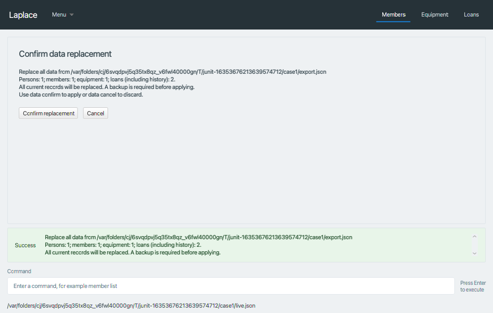
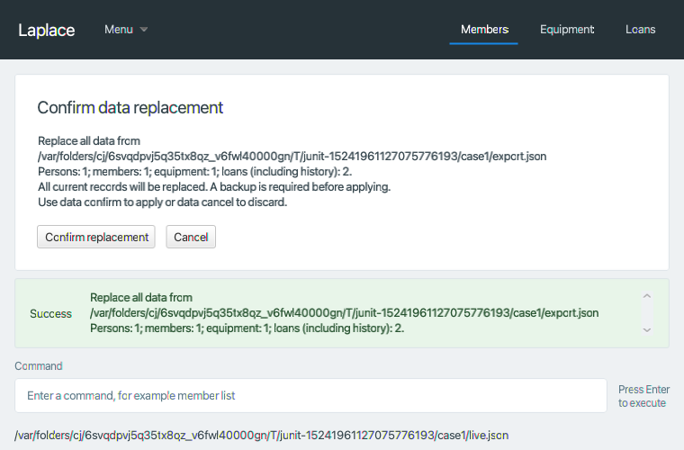

# Data-transfer verification

Base: team master `c4e2001de6ec09389d827260d1a985093aa64bc0` (PR #104).
Issue: [#106](https://github.com/AY2627S1-CS2103T-F15-2/tp/issues/106).
Environment: macOS ARM64, Java `25.0.3.fx-zulu`, project-declared JavaFX 17.0.7 runtime.

## Results

- `./gradlew test`: 755 tests, zero failures/errors/skips.
- `./gradlew check coverage shadowJar`: passes, including both Checkstyle tasks.
- `python3 scripts/check_transfer_coverage.py`: 142/142 changed executable lines and
  46/46 changed branches covered, **100% for both**, against the base above.
- New classes also have full individual line/branch coverage; zero branches means
  the class contains no branch instructions. Existing tests and coverage rules are unchanged.
- `python3 scripts/run_transfer_ui_tests.py`: passes the recorded fail-fast plan and
  real Confirm/Cancel button checks. Every transfer checks its exact save count;
  rejected inputs preserve the complete root and saved bytes.
- `./gradlew --init-script scripts/packaged-transfer.gradle packagedTransferTest`:
  3 additional tests, zero failures/errors/skips. Production classes and the preview
  FXML are asserted to load from the actual `Laplace.jar`; matching JavaFX natives
  are selected using the existing test runtime. This is automated packaged UI
  evidence, not a claim of physical mouse testing on all operating systems.
- Fresh ModelManager/LogicManager/MainWindow reloads preserve all saved collections;
  empty replacement clears the old identity selection.
- Repository checks and diff whitespace checks pass. The existing
  `docs/AboutUs.md:61` trailing-whitespace warning remains outside this change.
- The MarkBind documentation build passes for all 35 pages.

## Individual new-class coverage

| Production source | Lines covered/total | Branches covered/total |
| --- | --- | --- |
| DataCommand.java | 10/10 | 0/0 |
| DataCommandParser.java | 24/24 | 15/15 |
| DataTransferPanel.java | 5/5 | 0/0 |
| DataTransferPreview.java | 4/4 | 0/0 |
| DataTransferService.java | 47/47 | 11/11 |
| TransferPreviewResult.java | 4/4 | 0/0 |
| TransferSnapshotStorage.java | 31/31 | 14/14 |

## Failure coverage

Tests include invalid JSON/root/versions, unknown nested fields, duplicate JSON keys,
trailing values, null entries, invalid domain values, duplicate identities/open
loans and dangling references in open and closed history. Parser tests cover every
verb, invalid paths, quoted paths, blank/repeated/unknown fields and extra arguments.

Real atomic-writer regressions fail after a partial candidate write and during
replacement, checking original causes, every collection, prior bytes, candidate
cleanup, backup contents, retry and fresh storage reload. Backup-directory failure
aborts before persistence. Exports preserve existing destinations and reject the
active data path. Previews survive query/export/backup operations; cancellation,
new previews and successful mutations enforce the documented confirmation rules.

## Session and visual evidence

[Complete normalized input/output session](DataTransferSession.txt) ·
[Recorded test plan](https://github.com/AY2627S1-CS2103T-F15-2/tp/blob/codex/106-data-transfer/test/ui-test-plan.md) ·
[Format and integration contract](../DataTransferContract.md)

Only temporary paths and generated backup filenames are normalized in the session.
The two screenshots were visually inspected for wrapping and usable controls.

Hosted CI results are recorded separately in the PR for its exact published head.

The first Windows run exposed CRLF checkout handling in the test-plan reader:
the reader found zero cases instead of two and failed before executing a session.
The reader now normalizes line endings before parsing. A regression compares all
case names, inputs and expected outputs under LF and CRLF without changing the
expected UI feedback or excluding any test.
