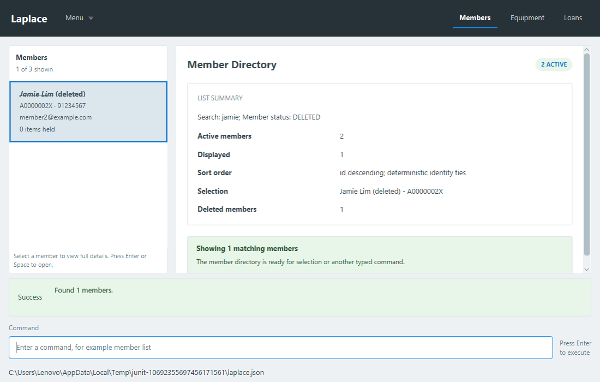
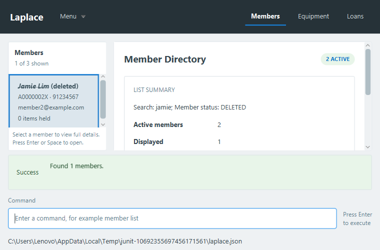

# Search/planning integration with member lifecycle

Integrated team baseline: `823efd5ebced1dd91a6627ee7881db0a9c67d175` (merged PR #116).
Fork branch: `duynguyen21007:search-and-planning`; PR #109 targets team master.
This is a local branch integration, not a merge of PR #109 into the team repository.

## Conflict resolution

The five conflicts are resolved by retaining both owners' behavior:

- User Guide includes search, member edit, soft-delete and restore (15 command routes).
- MemberListCommand reports active/deleted counts and explicitly resets to an all-records query.
- MemberCommandParser retains search, edit and restore, including all names in its diagnostic.
- MemberListPanel uses filtered/sorted snapshots while retaining the real deleted-card styling.
- MemberDirectorySummary shows filtered Displayed counts and independent active/deleted totals.

The incoming root/model/JSON/card/detail implementations and their tests are retained. No competing
lifecycle fields or schema are introduced. Member search defaults to active records; `status/deleted`
finds retained records for restoration, and `status/all` searches both states. List/reset still shows
both states, as required by the merged member lifecycle contract. Additional eligibility predicates
compose with the requested status. Equipment has no lifecycle metadata on this baseline, so its
existing eligibility extension remains unchanged.

Deleted members are excluded from possible-similarity warnings; exact identity reuse remains rejected
by the domain. Deletion/restoration reevaluates active queries and counts without destroying records.
The earlier correction distinguishing plain navigation from an explicit list/reset is preserved.

## Verification

- **79 focused tests pass; zero failures/errors/skips.** Selected directory/query/status tests,
  list commands/parsers, routing, actual shell searches and lifecycle, restore commands/parsers,
  lifecycle model/JSON tests and full command-routing integrations pass.
- Main/test Checkstyle, coverage generation and `shadowJar` pass. The core query/search/parser/group/
  duplicate helper classes retain **100% line and branch coverage** (174 covered lines, 119 covered
  branches, none missed, including enum/group declarations).
- Full local `gradlew.bat --no-daemon check coverage shadowJar --continue` completes **791 tests:
  790 passed, one failure, zero errors/skips**. The failure is the existing multiline clipboard-paste
  assertion in MainWindowShellTest, previously independently reproduced on the clean original team
  baseline. This full run is not reported as green. No test is disabled or weakened. Coverage is
  generated separately from its execution data with `coverage -x test`.
- Packaged application probe passes real CommandBox → LogicManager → model → temporary JSON for
  search, soft-delete, all-records reset with accurate active/deleted counts, deleted-only search,
  restore with query refresh, member edit and equipment search/delete, followed by JSON readback.
  Production MainWindow is loaded from Laplace.jar; only the disposable probe entrypoint is external.
- Existing deletion regressions still check criteria/sort preservation, identity selection, remaining/
  zero matching rows, one dispatch/save per mutation and explicit reset. Their reset expectations now
  retain deleted members, reflecting the incoming lifecycle contract rather than physical removal.
- New regressions verify active/deleted/all filtering, strict status parsing, active-only duplicate
  warnings, the real root/JSON lifecycle, status-aware summary counts, restoration and fresh-shell reload.

These inspected screenshots use the actual mounted shell and retained grey/struck-through member cards.
Both sizes retain readable criteria and counts; summaries scroll at the smaller size. Source snapshots
are regenerated under `build/reports/laplace/shell-search-deleted-members-*.png`.

Final-head fork/team CI and repository-check evidence are recorded in the PR body. The merge commit
uses an imperative capitalized subject under 50 characters and an explanatory body within 72 columns.
Published branch history is preserved, and no PR is merged by this work.
