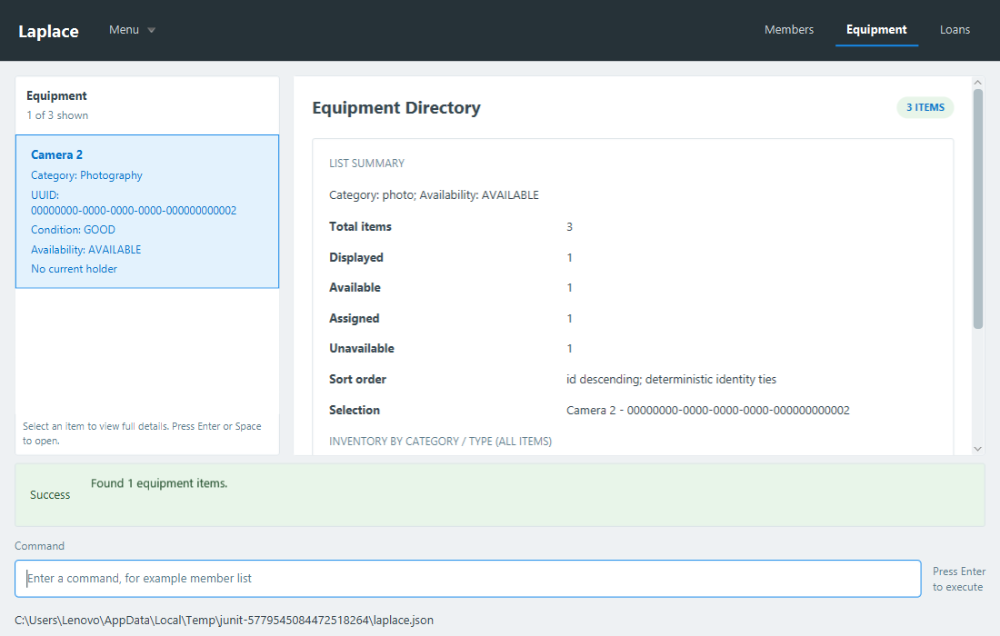
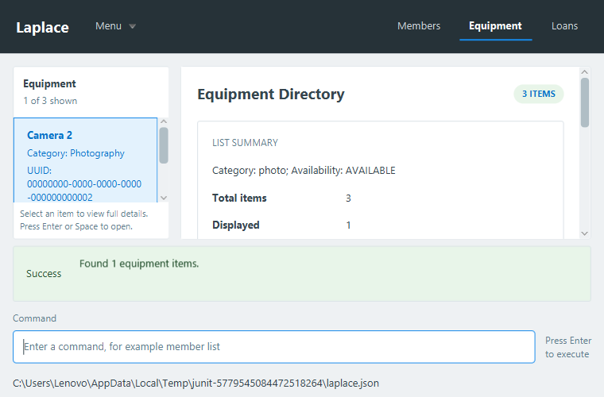
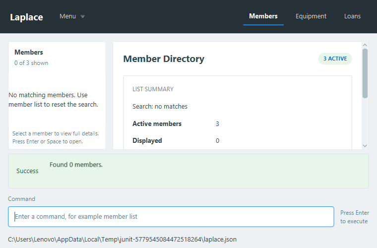

# Week 10 search and inventory planning verification

Issue: [#108](https://github.com/AY2627S1-CS2103T-F15-2/tp/issues/108).
Initial baseline: team master `c4e2001de6ec09389d827260d1a985093aa64bc0`.
Review integration baseline: `9885bb1e`, including the merged member-edit feature.
Fork branch: `duynguyen21007:search-and-planning`. No PR merge performed.
Latest [review fixes, integrated checks and commit audit](SearchPlanningReview.md).

## Implemented behavior

Member/equipment search commands carry immutable criteria through typed directory display requests.
Real lists, selection recovery and summaries use the same current-data query as command feedback.
Partial text, combined filters, selectable deterministic sorting, reset with list commands, zero-result
hints, identity-preserving rows and detail navigation are covered. Loan-only changes re-evaluate
holding/availability filters. Inventory groups include every current physical unit independently of
the filter. Advisory duplicate feedback includes existing identities without blocking legitimate units.

Search never calls saving, even when the storage implementation deliberately rejects every write.
Real temporary JSON tests compare records, collection order, saved bytes and fresh-model reloads.
Successful additions still use the existing transaction/persistence pipeline and retain every identity.
No new domain schema, lifecycle state, undo history, transfer service or shared CSS was introduced.

## Initial feature checks on Windows, Java 25.0.4

- Final focused run:
  `gradlew.bat --no-daemon test --tests '*DirectoryQueryTest' --tests '*DirectorySearchIntegrationTest' --tests '*MainWindowShellTest.search*' --tests '*DirectorySummaryTest' checkstyleMain checkstyleTest coverage shadowJar`
  **PASS: 19 tests, zero failures/errors/skips**, both Checkstyle checks, coverage and packaging.
- New core classes DirectoryQuery, DirectorySearchCommand, DirectorySearchCommandParser,
  DuplicateWarnings and InventoryGroups: **100% line and branch coverage** in that focused run
  (156 covered lines including enum/group declarations; 106 covered branches; none missed).
  This claim does not describe every changed line in existing shell/add-command classes.
- Full local `gradlew.bat --no-daemon check coverage shadowJar --continue`:
  **750 tests, 749 passed, one failure, zero errors/skips**. The failing test is the unchanged
  `MainWindowShellTest.pastedMultilineNotes_realInput_preservesSeparatorsPersistsAndRetainsRejectedCorrection`:
  Windows clipboard paste does not preserve the expected separator before command execution.
  Both production and test style checks passed in that initial full run.
- Confirmed baseline independently: detached clean checkout at `c4e2001d`, running only
  `gradlew.bat --no-daemon test --tests '*MainWindowShellTest.pastedMultilineNotes*'`, fails at the same
  paste assertion (baseline line 128). No test was disabled, excluded from the full run, or weakened.
- `gradlew.bat --no-daemon checkstyleMain checkstyleTest coverage shadowJar -x test` passed after the
  full-run failure, generating coverage from its execution data. This is a build/report operation,
  not a claim that the full suite passed. The later 19-test run above is separately identified.
- Packaged source-mode Java probe passed with only `build/libs/Laplace.jar` on the application classpath:
  actual AddressBookParser/search execution, real ModelManager, query result identity, list/summary
  construction and FXML/CSS layout. It asserts production classes originate from Laplace.jar, uses only
  in-memory data and never touches saved user data. Java SE/compiler/unsupported modules were available;
  JavaFX classes/natives came from the JAR. This is component evidence, not manual cross-platform acceptance.

## Mounted application evidence

MainWindowShellTest submits actual input through CommandBox, LogicManager, ModelManager and temporary
disk storage. The search cases check exact result rows/counts, query/order labels, zero matches,
invalid-input retention, list reset, one Enter activation of the correct filtered identity and refresh
after a real return command. Existing full-shell tests remain enabled.

These inspected snapshots are generated from the mounted real shell, with test-managed temporary data.
The summaries scroll to expose remaining totals, selection and inventory groups at small sizes. Header
labels wrap instead of truncating the directory name. Tests regenerate original snapshots under
`build/reports/laplace/shell-search-*.png`.

## Scope and later shared integration

Lifecycle metadata is absent from the verified team baseline. Query/count helpers accept eligibility
predicates, tested to exclude records before availability lookup. Actual soft-deletion eligibility
must be wired after Keegan/Arjo's domain changes merge; it is not simulated or claimed complete here.
Isaac's later history pipeline must exclude `isReadOnly()` queries. Transfer PR #107 was closed without
merging; the review branch integrates member-edit baseline `9885bb1e`. Later shared integrations must
retain the query payload, filtered selection recovery and no-save query boundary.
See [search contract and usage](../commands/search-and-planning.md).

The search/planning scope is independently complete on this baseline and can be reviewed now. Later
lifecycle/history/transfer work does not require copying unmerged implementations into this branch.
The local baseline clipboard failure is reported separately from hosted CI, which passed all three
platforms on the original feature commit. Final-head hosted results are linked in the PR body.
This report does not assert complete Week 10 lifecycle/transfer/undo integration or manual desktop acceptance.
