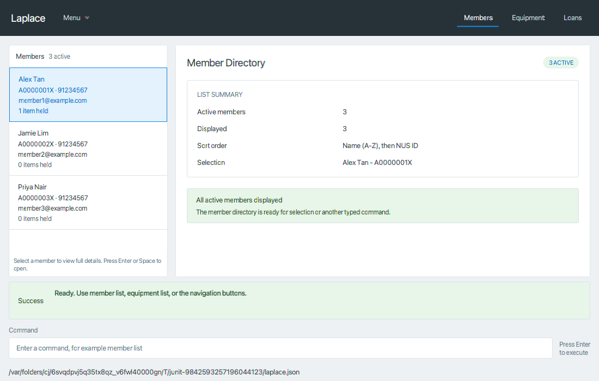
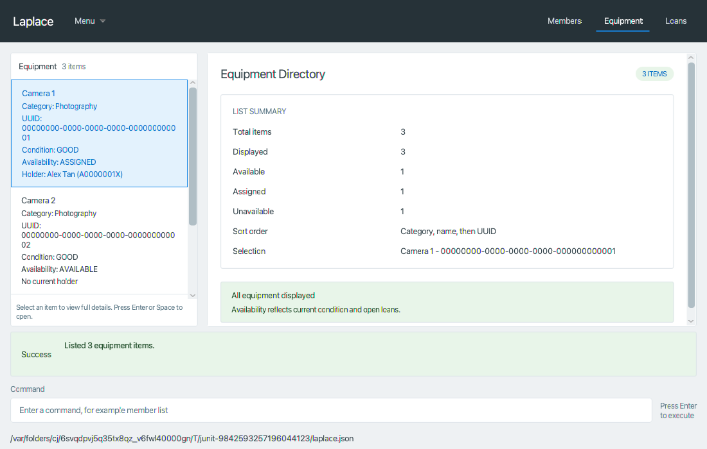
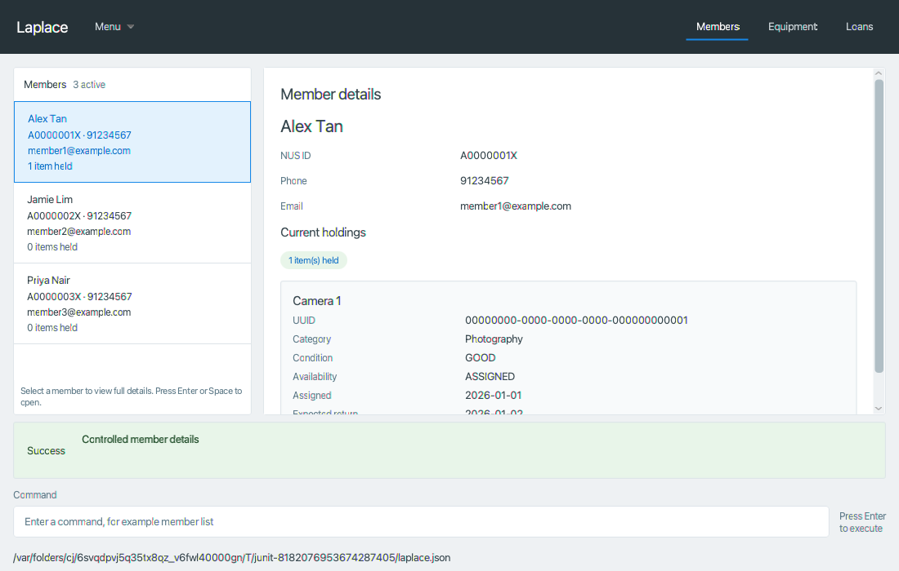
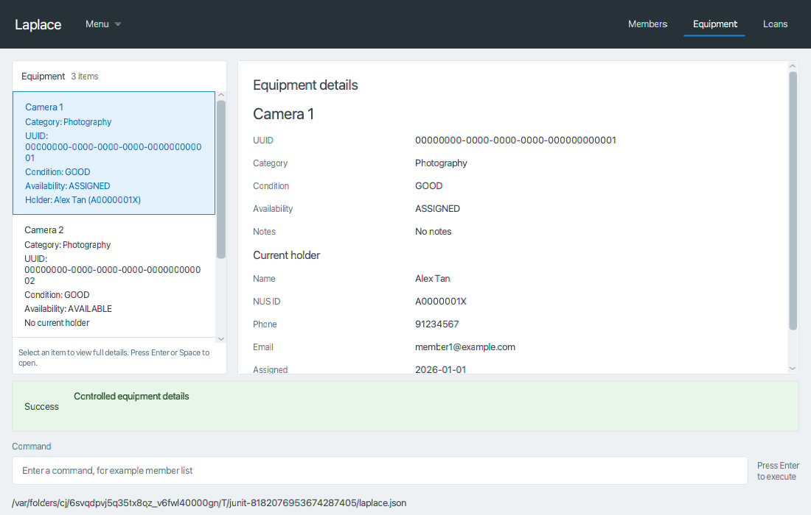
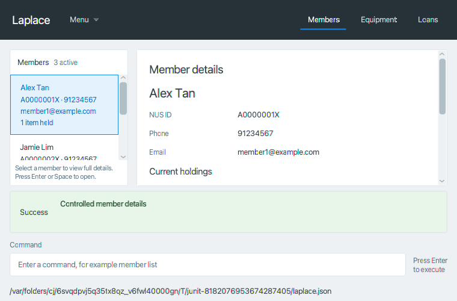
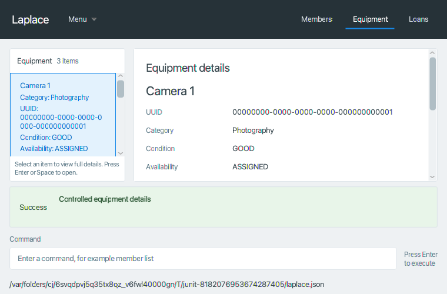
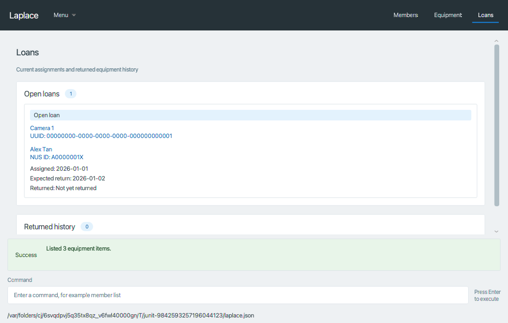
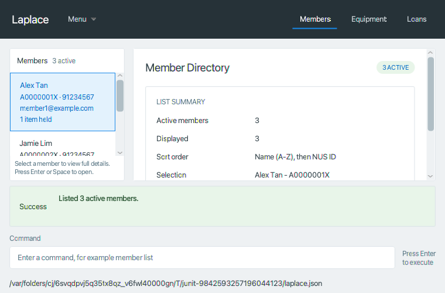
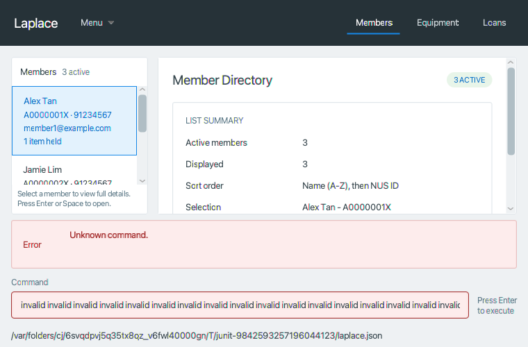

# Laplace shell verification

This implements [issue #91](https://github.com/AY2627S1-CS2103T-F15-2/tp/issues/91) around the
components now available on team master `bb996649` (merged detail-component PR #94).
The window mounts the real member/equipment lists, cards, summaries, MemberDetailsPanel,
EquipmentDetailsPanel, Loans panel and legacy Persons list. The shell does not modify those owned
components or activate their command routes. [ReviewResponse.md](ReviewResponse.md) records all
six review items and the open [final acceptance tracker #75](https://github.com/AY2627S1-CS2103T-F15-2/tp/issues/75).

## Behavior and ownership

The first screen is Members with the first sorted identity selected and the summary visible.
The header has Members, Equipment and Loans buttons. Directory columns start at 28%/72% and
retain that proportion on resize. Feedback and command input remain below the scrollable content.
The Menu exposes Help, legacy Persons and Exit; F1 opens Help even from command input.
Saved window geometry is retained within the current screen's usable bounds.

Members and Equipment dispatch `member list` and `equipment list` through the same command pipeline
as input. Loans opens its read-only panel directly. A row or loan identity link dispatches exactly
`member view nus/NUS_ID` or `equipment view uuid/UUID`, once per explicit activation.
Programmatic startup selection, selection restoration and refresh never dispatch commands.

Navigation uses `DisplayRequest`, not feedback text. Help and Exit take precedence. An unchanged
request retains the screen. Legacy commands still have their own Persons screen. Blank input is
ignored; successful input clears; parse, command and save failures retain input for correction.
Both success and failure have readable text, a status label and a different feedback background.
Long feedback wraps and scrolls rather than expanding the command area offscreen.

The shell subscribes once to the live member, equipment, loan and filtered-person lists.
Changes coalesce into one FX-event-loop refresh after a model operation. Refresh rebuilds related
cards, holdings, availability, summaries and loan history, retaining identities and an explicitly
empty selection. Deleting a selection chooses the next row at its former sorted position, or the
last surviving row; an empty directory clears selection. Real detail fields refresh alongside cards/summaries/Loans, including while another tab is active.
Removed detail identities leave stale detail mode and return to the corresponding summary. Disposal removes subscriptions and event handlers, and cancels queued refresh work.

A save failure does **not** imply rollback: the existing pipeline can mutate memory before saving.
The shell shows the actual error, retains navigation/input and refreshes actual in-memory state.

## Current integration limits

Only member/equipment **list** family routes are active on this baseline. Other family routes
return `NotImplementedCommand`. That placeholder returns a *successful* `CommandResult` with
`LEGACY_PERSONS` and not-implemented feedback, and the pipeline attempts to save unchanged data.
The shell cannot claim that those operations executed their intended business behavior.

For explicit row/loan-link activation, a generic legacy result cannot fulfill the requested detail
navigation. The shell retains the current screen, displays the original feedback as unavailable,
and shows a notice. This guard checks the typed result and the known activation source; it does
not parse command feedback. Typed console commands continue to honor their actual display requests.

Typed member/equipment detail requests now select the exact identity in the left list and mount
the real right-hand details panel using `showMember`/`showEquipment`. Directory requests mount the
summaries. Tests include actual component view-command results and assert contacts, notes,
holdings, holder identity/contact information, availability and dates. Result delivery to the
shell remains controlled while the actual family routers are placeholders; no routed success or
automatic save is claimed for those tests. No replacement parser or mock detail panel is shipped.

Assignment/return and deletion refresh tests mutate the real model on the FX thread because those
family routes are still pending. Actual routed writes and complete milestone acceptance remain
under the owners' integration work and the final gate in [Verification.md](Verification.md).

The supplied [MVP document](https://docs.google.com/document/d/1XzYR2IpGc__mSZEy5GKMmVK8809j3Ln42VA8_9-va48/edit)
was checked against its "Laplace MVP Feature Specification" section. Its save-failure guarantee
requires separate transaction work; the current test below remains a truthful report of the
existing behavior. Completed history is still shown by Isaac's current LoanPanel despite being
excluded by the newer MVP. Shared validation/normalization, UUID collision retry and the new
member-held-item sort order also need their owners' updates. These dependencies are recorded in
#75 and ReviewResponse.md; the shell tests do not certify full MVP compliance.

## Tests and repeatable checks

Use Java 25 (`sdk use java 25.0.3.fx-zulu` on the configured macOS machine). The existing test runtime
selects matching JavaFX 17.0.7 native jars. Run in a graphical session; Linux requires Xvfb.

```sh
./gradlew test --tests '*CommandBoxTest' --tests '*ResultDisplayTest' --tests '*MainWindowShellTest'
./gradlew check coverage shadowJar
./.github/run-checks.sh
```

The shell suite uses the actual MainWindow FXML, real components, ModelManager, LogicManager and
JSON storage. It covers one-shot submission/activation, failure recovery, tab commands and Loans,
typed requests, Help/Exit, selection recovery, root replacement, loan-only refresh, teardown,
legacy contrast, geometry and saved-data reload. Controlled typed-result and disk-failure fixtures
are identified separately in the test class. Tests fail on graphical errors and do not skip them.

The generated session record is `build/reports/laplace/shell-session.txt`. It records actual inputs,
feedback, retained input, dispatched commands and save counts. Generated screenshots include
normal/small Members, Equipment, both real details, Loans and legacy Persons, plus error, empty, missing and long-text states
under `build/reports/laplace/`. These are snapshots of the actual mounted shell, rather than the
earlier component preview fixture. The retained example session is [ShellSession.txt](ShellSession.txt).

## Local evidence

Java 25 validation passed on ARM macOS with 638 tests and zero failures, errors or skips.
Checkstyle, coverage and the packaged `shadowJar` build passed. Repository-wide checks passed with
the existing trailing-whitespace warning in `docs/AboutUs.md:61`, outside this change's ownership.

A separate temporary Gradle verification task removed exploded main classes/resources from its
classpath and loaded the shell from `build/libs/addressbook.jar`. All 24 shell/input/feedback tests
passed. The startup test asserted that MainWindow's code source was that JAR and all shell and
mounted-panel FXML plus the shared stylesheet used `jar:` classpath resources. This starts real
MainWindow stages from the packaged code; it does not establish complete command/detail integration
or a standalone production launch on every OS. The temporary task is not a build-system change.
MainWindow has 221/221 JaCoCo lines and 91/94 branches covered; tests now exercise the legacy menu,
equipment Space activation, selection event handlers and hidden-window disposal identified by
coverage review. No tests were skipped and no coverage exclusions were added.

A standalone `seedu.address.Main` launch from the packaged code and matching native runtime reached
normal MainApp/UiManager startup in a fresh temporary data directory without a loader/resource
error. The desktop tool could not bind the unbundled Java window, and a temporary native launcher
also timed out. Those attempts do not establish inspected interactive typing/navigation/reload;
only the packaged shell test suite establishes its explicitly described controlled scenario.
The test-only processes were closed and no launcher/runtime changes are shipped.

The screenshots below were visually checked against `docs/images/Ui.png`. Their data and long-text
fixtures are supplied by tests; the window, cards, lists, summaries, details and Loans panel are production
components. Long stored-value fixtures check layout robustness; they do not establish acceptance of
values outside the newer MVP's typed-input limits. Normal content size is 1100x700, and the smaller content size is 760x500.

### Members



### Equipment



### Real details (controlled typed/component-result delivery while routes remain pending)









### Loans



### Small window



### Error recovery



## Manual acceptance record

| Aim | Input/action | Expected result |
| --- | --- | --- |
| Startup | Open shell with saved members | Members, first sorted selection, summary; no view command |
| Ignore empty input | Enter with spaces/tabs | No command/save; input remains available |
| List/navigation | `member list`, Equipment tab, Members tab | Correct real summary; one command/save each |
| Rejection and recovery | `equipment list extra`, then `equipment list` | Error retains input/view/data; valid input clears and navigates |
| Current pending view route | Activate selected row; activate a loan identity link | Exact prefixed identity command once; retain screen with unavailable notice |
| Real details | Deliver the actual component view result by controlled Logic fixture | Exact identity and contacts/notes/holder/dates; matching left row; no automatic save claim |
| Loan refresh | Assign/return through the model with member details, equipment details or Loans active | Real details, holdings, holder, availability and loan rows refresh; no activation command |
| Selection after deletion | Delete selected identity through the model | Deterministic surviving selection or empty directory; no callback |
| Root reset | Replace root data with an empty book | Empty lists/counts and no stale detail target |
| Save error (current behavior, MVP prerequisite pending) | Inject disk failure during a real legacy add | Error/retained input; actual in-memory person exists; no false save or rollback claim |
| Keyboard/lifecycle | F1 from input; `help`; `exit`; reopen from saved JSON | Help without navigation; both stages close; reload preserves records |
| Long text/resize | Long member/equipment names, 760x500 window | Lists/summaries scroll; feedback/input stay accessible |
| Disposal | Queue data change, dispose, then mutate root | Old shell receives no queued or later refresh |
